# Notree 시스템 아키텍처

- 기준 문서: 요구사항 정의서 v0.4.4 (Google Sheet `notree-요구사항-정의서-v0.4`)
- 작성일: 2026-11-16, 개정: 2026-11-18 (큐·워커 실행 규칙 ADR-0017~0019, 편집기 ADR-0020, 모듈 의존 단방향화, Q&A 후속 단계와 계정 한도 적용 대상 ADR-0022), 2026-11-19 (`capture`를 `notebook`·`learner` 아래 층으로 ADR-0024, F5 출제 앞단, 추적표 '지금 단계' 열)
- 상태: 설계 합의안. 구현과 측정은 하지 않았다.
- 용어는 [GLOSSARY.md](../GLOSSARY.md)를, 결정 이유는 [docs/adr/](adr/)를 따른다.

## 1. 시스템 컨텍스트

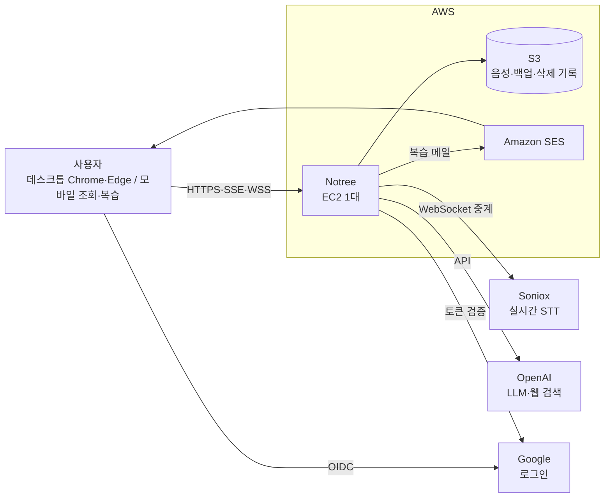

- 브라우저는 외부 서비스 키를 갖지 않는다(SER-003). 음성은 항상 우리 서버를 거쳐 Soniox로 간다.
- 외부 처리 위탁 대상은 Soniox, OpenAI, AWS(SES, S3)다. 모두 동의 화면에 고지한다(COR-005).

## 2. 컨테이너

EC2 한 대에서 docker compose로 띄운다. `postgres`와 `redis`를 뺀 앱 서비스는 하나의 백엔드 이미지에서 실행 진입점만 다르다([ADR-0004](adr/0004-single-ec2-docker-compose.md)).

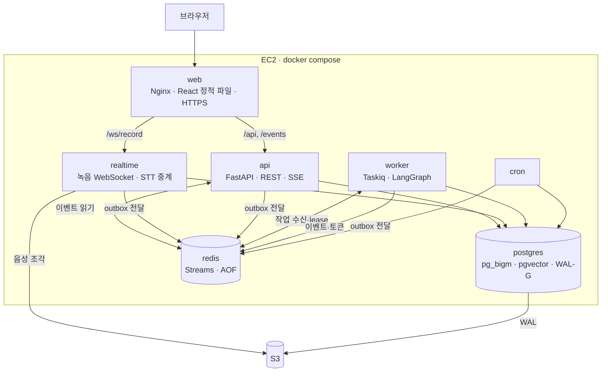

| 서비스 | 책임 | 주요 요구사항 |
|---|---|---|
| `web` | React 정적 파일, HTTPS(Let's Encrypt), 경로별 라우팅, 릴리스 시 새 녹음 연결을 새 `realtime`으로 보냄 | SER-004, COR-003 |
| `api` | REST, Google 로그인과 서버 세션, SSE(`/events`), 권한 확인, 작업 등록 | SFR-044, SER-002, PER-004 |
| `realtime` | 녹음 WebSocket, Soniox 중계, STT 세션 교체, 전사 구간 저장(발화 종료·15초 상한), 음성 5초 FLAC 조각 업로드 | SFR-002~004, SFR-046, DAR-001, QUR-003·008 |
| `worker` | Taskiq 작업 실행(ADR-0017), 실시간 요약(Redis에만 보관), 최종 노트, 과목 노트 업데이트 그래프(LangGraph, ADR-0009), Q&A 작업(답변 그래프 + 후속 단계, ADR-0022), 출제·채점, 검색 자료 갱신, outbox 회수 루프. 교체할 때는 새 작업 수신을 멈추고 유예 시간 뒤 종료하며, 남은 작업은 인계된다 | SFR-006~008, SFR-016~020, SFR-034~036, QUR-004 |
| `cron` | 09:00 KST 메일 묶음, 매시 만료 삭제(음성, 휴지통, 탈퇴, STT 원본), 백업 점검 | SFR-038, DAR-001, DAR-006·007, SFR-045 |
| `postgres` | 모든 원본 데이터, 작업 상태와 실행 시도 번호, outbox, 비용 장부, RLS | DAR 전반, SER-002, PER-003 |
| `redis` | 작업 Stream(Q&A·배경 분리), 실행 lease, 사용자별 이벤트 Stream. 원본이 아니라 백업하지 않고, 잃어도 정확성에 영향이 없다(ADR-0018) | [ADR-0001](adr/0001-redis-streams-worker.md), [ADR-0005](adr/0005-sse-for-events-websocket-for-recording.md), [ADR-0017](adr/0017-taskiq-delivery-sdk-retries.md) |

**동시 실행 한도** (PER-003 5): 계정당 녹음 1개, Q&A 1개, AI 작업 전체 2개. 사용자가 요청해서 시작하는 작업(녹음, Q&A, 채점, 사용자가 누른 재생성·재시도)에만 적용하고, 그 요청을 받는 `api`·`realtime`이 작업 등록 트랜잭션에서 `users` 행을 잠그고 센다. 시스템이 이어서 만드는 작업(실시간 요약, 최종 노트, 과목 노트 업데이트, 검색 자료 갱신)은 종류별 상한(F1·F3)과 Q&A·배경 작업의 워커 동시 실행 수(10장)로 묶는다([ADR-0022](adr/0022-qa-followup-stages-in-one-job.md), PER-003 5 변경안).

## 3. 모듈

하나의 코드베이스(`backend/notree/<모듈>`)를 도메인 모듈로 나눈다. 모듈끼리는 서로의 공개 함수를 직접 호출하고, 오래 걸리는 일은 작업으로 넘긴다. 의존은 아래 그림의 방향으로만 한다. 같은 층끼리나 거꾸로 알려야 할 일이 생기면 호출하지 말고 작업을 등록한다.

| 모듈 | 책임 | 담당 |
|---|---|---|
| `capture` | 과목과 맥락 버전, 강의, 녹음 세션, STT 세션, 전사(STT 원본·정정 버전), 수정 제안, 음성 | 김민규 |
| `notebook` | 강의 노트, 과목 노트, 블록 리비전과 노트 버전, 변경안(`note_changes`) 적용·대기 해소·되돌리기, 출처 표시 상태, 검색, 내보내기 | 이근욱 |
| `tutor` | 대화, Q&A 답변, 노트 반영 판단(변경안을 `notebook`에 제출), 보강 블록 내용 | 이근욱 · 임서연 |
| `learner` | 개념, 관찰, 관찰 대체, 이해 상태 재계산 | 임서연 |
| `review` | 복습 단위, 복습 문제, 답안, 채점과 재평가, FSRS 일정과 재계산, 추천, 메일·캘린더 | 임서연 |
| `account` | Google 로그인, 서버 세션, 동의 기록, 탈퇴, 계정 용량 | 김민규 |
| `platform` | 작업 큐, 반영 확인, 비용 예약, 삭제 묶음과 삭제 기록, RLS 세션, 이벤트 발행, 객체 저장소, 로그 필터 | 공통 |

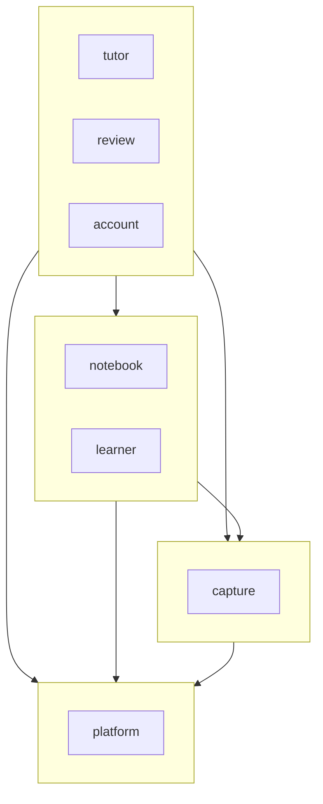

- 상자 하나가 층 하나다. 화살표는 위층 모듈이 아래층 모듈의 공개 함수를 부를 수 있다는 뜻이고, 바로 아래층이 아니어도 된다. 같은 층끼리, 그리고 아래에서 위로는 부르지 않고 작업 등록(`enqueue`)으로 알린다.
- 순환을 없애려고 두 가지를 옮겼다(2026-11-18). 변경안은 `notebook`의 데이터다. 과목 노트 업데이트가 끝나면 대기 중인 변경안을 `notebook`이 직접 처리하므로 `tutor`를 부를 일이 없다. 재평가(SFR-027)는 새 채점을 만드는 일이라 `review`가 하고, `learner`에는 관찰 대체와 이해 상태 재계산만 요청한다.
- `capture`를 `notebook`·`learner` 아래 층으로 내렸다(2026-11-19, [ADR-0024](adr/0024-capture-below-notebook-learner.md)). 과목·강의·전사는 `capture`의 데이터인데 모든 모듈이 읽어야 해서다. `capture`가 `notebook`을 부르던 호출은 없어졌다. 녹음 세션이 끝나면 `capture`가 `enqueue("final_note", target_id=강의 ID)`로 알리고, `final_note` 처리 함수는 `notebook`에 있으며 전사를 `capture`의 공개 함수로 읽는다. `account`는 계정 용량을 세려고 `capture`를 읽는다.
- 모듈 사이 import 방향은 `scripts/check.sh`의 `lint-imports`가 검사한다. 계약은 `backend/pyproject.toml`의 `[tool.importlinter]`에 있고, 이 그림과 같은 방향만 허용한다.

## 4. 핵심 흐름

### F1. 녹음 → 전사 저장 → 실시간 요약

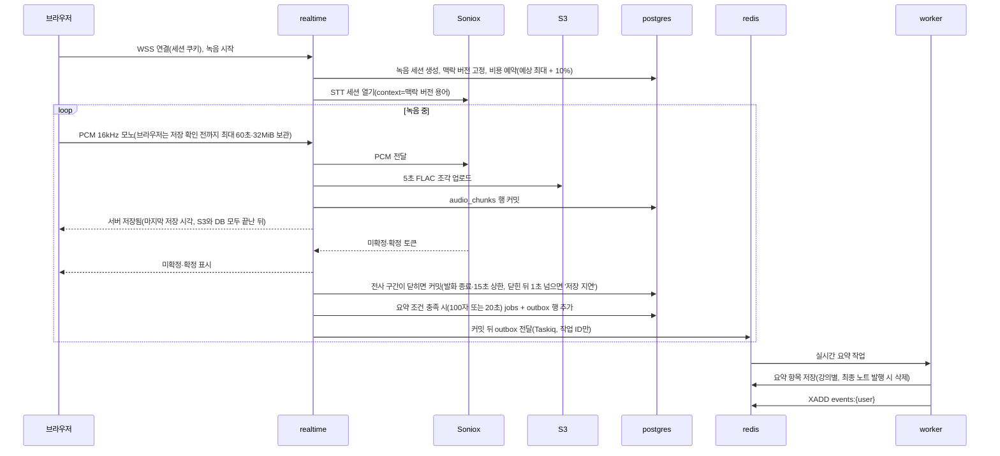

- **재연결** (QUR-003, SIR-001): 브라우저↔`realtime` 연결이나 `realtime`↔Soniox 연결이 끊기면 1·2·4초 간격으로 3회 다시 연결한다. 그동안 음성은 버퍼에 보존한다. 모두 실패하면 시스템 중지 또는 부분 완료로 끝내고, 복구 업로드를 제공한다.
- **비용 예약 연장**: 30분 단위로 연장한다. 연장할 수 없으면 경고한 뒤 예약 시간에 정상 종료한다(PER-003 3).
- **세션 종료**: 사용자 종료, 연결 끊김 5분, 180분 상한 중 먼저 오는 시각이다. 이 시각부터 음성 만료 7일을 센다(DAR-001 4).
- **실시간 요약 개수** (SFR-006 5): 강의당 대기 1개는 `jobs_live_summary_queued`가 막는다. 실행 1개는 처리 함수가 지킨다. 같은 강의의 다른 요약이 실행 중이면 아무것도 하지 않고 끝내고, 실제로 요약한 작업이 끝날 때 아직 요약하지 않은 확정 전사(Redis에 둔 '마지막으로 요약한 구간' 이후)가 남아 있으면 하나를 더 등록한다. 녹음이 끝나 새 전사가 오지 않아도 남은 구간이 요약된다.

### F2. 녹음 중 용어 적용 (STT 세션 교체)

[ADR-0003](adr/0003-stt-session-swap-for-terms.md)

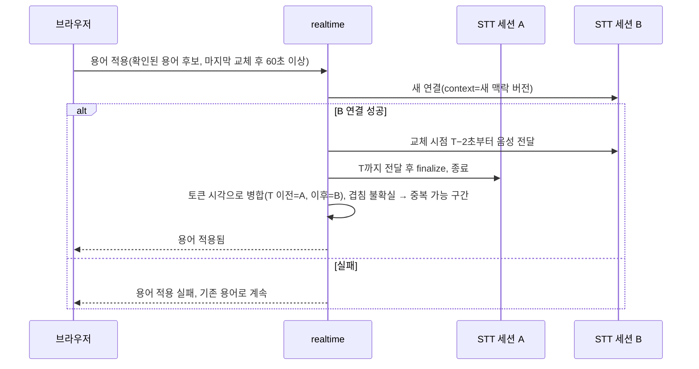

전사 구간마다 어떤 맥락 버전으로 받아 적었는지 기록한다.

### F3. 세션 종료 → 최종 노트와 수정 제안 → 과목 노트 업데이트

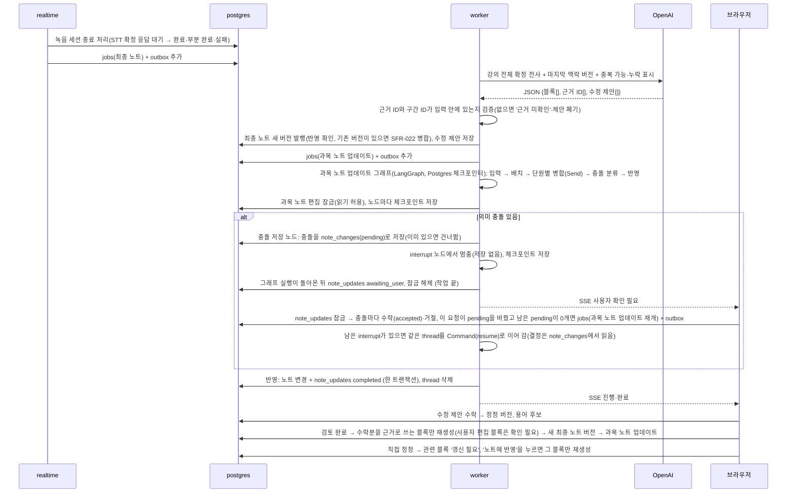

- **과목 노트 업데이트** (SFR-008): 과목 노트당 실행 중 1개, 재개 대기 1개, 대기 요청 1개다. 연속 실행 10분이면 일시정지한다. 일시정지하면 중간 결과를 보존하고, 취소하면 세대 번호를 올려 늦은 결과를 버린다. 잠금은 DB `notes.locked_until`이고, 작업이 20초마다 60초 뒤로 연장하므로 비정상 종료돼도 60초 안에 풀린다(QUR-002, [ADR-0018](adr/0018-db-fencing-redis-lease.md)).
- **재개와 사용자 확인** ([ADR-0023](adr/0023-course-update-checkpointer-and-interrupt.md)): Postgres 체크포인터(`langgraph` 스키마, `thread_id = note_updates.id`)가 노드마다 상태를 저장하고, 일시정지·인계 뒤에는 마지막 체크포인트부터 이어 간다. 단원별 병합은 `Send`로 단원마다 병렬 실행하고, 끝난 단원은 다시 하지 않는다. 의미 충돌(SFR-008 4)은 충돌 저장 노드가 `note_changes(status='pending', note_update_id)`로 저장하고, 다음 노드가 `interrupt`로 멈춘다. LangGraph는 재개할 때 `interrupt()`를 부른 노드를 처음부터 다시 실행하므로 그 노드에서는 저장하지 않고, 충돌 저장 노드는 이미 저장된 변경안이 있으면 건너뛴다. 사용자가 모두 결정하면 재개 작업이 이어 가고, 반영 노드가 `accepted`인 변경안을 반영한다. 반영 노드는 노트 변경과 `note_updates.status = 'completed'`를 한 트랜잭션으로 커밋해 이중 반영을 막는다.
- **단원**: 과목 노트의 최상위 제목 블록과 다음 최상위 제목 앞까지의 블록. 그 제목 블록 ID로 식별한다. 배치 단계에서 LLM이 새 강의 블록마다 기존 단원이나 새 단원을 정하고, 이 계획은 체크포인트에 남는다.
- **노트 재생성과 사용자 편집** (SFR-022, QUR-002): 강의에 녹음 세션이 추가되거나 수정 제안을 반영해 최종 노트를 다시 만들 때도 과목 노트와 같은 규칙을 쓴다. 사용자가 작성한 블록은 원문 그대로 두고, 사용자가 고친 AI 블록은 충돌로 확인을 요청한다. 처리 결과는 `note_changes`(origin `lecture_regen`)에 남는다.
- **STT 원본 삭제**: 정정이 확정되고 7일 뒤 `cron`이 그 구간의 STT 원본을 지운다. 블록 근거는 정정 버전으로 옮기고, 원본을 근거로 쓰던 블록은 "갱신 필요"를 유지한다. "출처 삭제됨"으로 처리하지 않는다.

### F4. Q&A 작업 → 노트 반영

[ADR-0009](adr/0009-langgraph-graphs-with-openai-sdk.md), [ADR-0022](adr/0022-qa-followup-stages-in-one-job.md). `qa_answer` 작업 하나가 답변 단계(답변 생성·저장, LangGraph 그래프) → 반영 단계(반영 판단·위치 결정·정책 검사) → 관찰 단계(관찰 추출)를 순서대로 한다. 반영·관찰 단계는 그래프 밖의 일반 함수다. MVP는 검색 대신 과목 노트를 통째로 넣는 짧은 그래프를 쓴다([schema-mvp.md](schema-mvp.md) 'MVP Q&A 흐름'). 전달 경로는 아래와 같다.

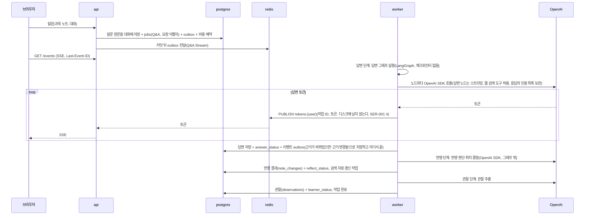

작업 안의 흐름이다. ◇는 LLM이 판단하는 지점, ⬡는 코드가 정하는 지점이다. 위쪽 묶음만 LangGraph 그래프이고, 아래쪽 묶음은 같은 작업 안에서 이어지는 일반 함수다.

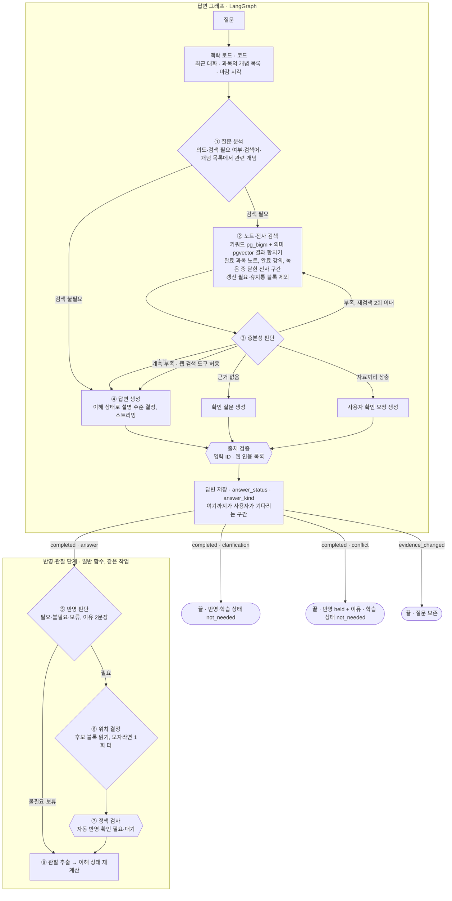

- **판단 지점**: ①·③·⑤·⑥은 LLM이 구조화 출력으로 다음 갈래를 고른다. ⑦은 SFR-020 정책을 코드로 검사한다. 사용자가 작성·편집한 블록이나 노트 내용과 상충하는 변경은 '확인 필요', 과목 노트 업데이트 중이거나 근거 강의가 미완료면 '대기'다.
- **상한**: 재검색 2회, 위치 결정의 추가 조회 1회. 호출당 입력은 16k다. 답변 단계의 누적 입력 64k·출력 6k·90초(PER-004 4)를 지킨다. 검색 중 누적 입력이 차면 재검색을 멈추고 모은 근거로 ④에 간다. 출력 한도에 걸린 답변은 `completed`로 저장하고 `messages.output_truncated`를 켜며, 학습 증거로 쓰지 않으므로 관찰 단계를 건너뛴다. 90초를 넘기면 `failed`로 저장하고 본문은 남기지 않는다(SFR-021 3). 반영·관찰 단계는 사용자가 기다리는 구간 밖이라 이 누적 상한에 넣지 않고, 합계 30초 마감과 호출마다 timeout·비용 예약으로 묶는다(PER-004 4, ADR-0022). 두 마감은 SDK 재시도와 그 대기를 포함한 단계 전체에 걸리고, 마감을 넘긴 단계와 그 뒤 단계만 실패한다. 재시도는 같은 답변 메시지에서 남은 단계만 한다.
- **저장 범위**: 그래프 상태(검색 후보, 프롬프트, 미완성 답변)는 메모리에만 둔다(SER-001 4). 단계마다 결과와 완료 표시(`messages.answer_status`, `reflect_status`, `learner_status`)를 한 트랜잭션으로 커밋한다. 반영·관찰 단계가 실패해도 답변은 남고, 반영·학습 상태 결과가 각각 실패로 표시된다(SFR-021). 인계·재시도 때는 완료 표시를 보고 남은 단계만 다시 실행한다(5장 작업 재개). 반영·관찰 단계는 `answer_status = 'completed'`일 때만 돈다. 확인 질문과 상충 안내도 출처 검증을 거쳐 완료 답변으로 저장하고 `answer_kind`(`clarification`·`conflict`)로 구분하지만, 노트에 넣을 내용도 학습 증거도 아니므로 두 단계를 건너뛰고 같은 트랜잭션에서 학습 상태를 `not_needed`로 쓴다. 반영 결과는 확인 질문이면 `not_needed`, 상충 안내면 근거 충돌이므로 `held`와 판단 이유(무엇이 상충하는지)다(SFR-017 4).
- **Q&A 한도 점유**: 반영·관찰 단계가 도는 동안에도 계정당 Q&A 1개 한도를 잡는다. 그동안 다음 질문은 '답변 정리 중'으로 보내기를 막는다(ADR-0022).
- **웹 근거**: 웹 검색 도구 응답의 인용 목록에 있는 URL만 근거로 저장한다. 답변 본문에만 나온 URL은 버린다(ADR-0007). 검증을 통과하지 못한 근거만 버리고 답변은 저장한다.
- **개념 목록**: ①은 맥락 로드가 읽은 과목의 개념 목록 안에서 관련 개념을 고르고, ④는 그 개념의 이해 상태로 설명 수준을 정한다(SFR-026 1). 이름을 지어내면 DB의 개념과 맞지 않아 이해 상태를 못 읽는다.
- **기록**: 노드마다 `job_stages`에 노드 이름과 소요 시간, `ai_calls`에 사용량을 남긴다. 원문은 남기지 않는다.

- **과목 노트가 업데이트 중이면** 반영 요청을 대기시킨다. 근거 강의의 최종 노트가 아직 없을 때도 대기시킨다. 대기는 과목 노트당 20개까지이고, 넘으면 "답변 완료·노트 반영 보류"로 표시한다(SFR-020 5·7).
- **화면 연결이 끊겨도** 작업은 계속된다. 재접속하면 SSE가 `Last-Event-ID`부터 다시 보낸다. 이벤트가 이미 잘렸으면 다시 불러오기 신호를 보낸다. 작업이 인계돼 실행 시도 번호가 바뀌면 화면은 이전 시도의 임시 답변을 비운다([ADR-0005](adr/0005-sse-for-events-websocket-for-recording.md)).
- **노트 반영 적용**은 `notebook`이 한다. `tutor`는 반영 판단 결과를 변경안으로 제출만 한다. 과목 노트 업데이트가 끝나면 `notebook`이 대기 변경안을 직접 처리한다.

### F5. 개념·복습 문제 출제 → 복습 제출 → 채점 → 이해 상태·일정

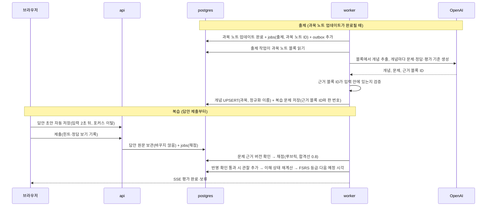

- **개념과 출제** (SFR-028~034): 과목 노트 업데이트가 완료되면 `notebook`이 출제 작업을 등록한다(MVP 스키마의 `generate_card`, 대상은 과목 노트). `notebook`은 위층인 `review`를 부를 수 없어서 작업으로 알린다(3절). `review`의 처리 함수가 과목 노트 블록을 `notebook`의 공개 함수로 읽고, 블록에서 뽑은 개념을 `learner`의 공개 함수로 과목 안의 정규화 이름에 UPSERT한 뒤([ADR-0015](adr/0015-per-course-concepts.md)), 개념마다 복습 문제를 만든다. 문제의 근거는 블록 ID와 인용한 판 번호다. 개념은 이 작업에서 생긴다. Q&A는 개념을 만들지 않고 있는 목록에서만 고른다(F4). 개념 추출과 출제를 한 호출로 할지, 어떤 블록과 개념을 고를지는 `review`에서 정한다.
- **도래**: 별도 작업 없이 `예정 시각 <= 지금` 조회로 목록에 나온다. 지연이 0이라 PER-005가 충족된다.
- **같은 답안 재처리**: 멱등 키를 둬서 한 번만 반영한다(SFR-036 2). 같은 개념에 답안이 동시에 들어오면 복습 단위 행을 잠그고 순서대로 처리한다.
- **재평가** (SFR-027, `review`): 보관한 답안을 다시 채점해 새 `GRADING`을 만들고 이전 평가를 '대체됨'으로 표시한다. 그 복습 단위의 유효한 `review_logs`를 시간순으로 다시 적용해 FSRS 상태를 재계산한다. FSRS는 고정 버전이고 무작위 분산이 없어(SFR-032) 결과가 결정적이다. 새 예정 시각이 이미 지났으면 바로 도래한다. 이해 상태는 `learner`가 유효한 관찰로 다시 계산한다.

### F6. 삭제와 복원

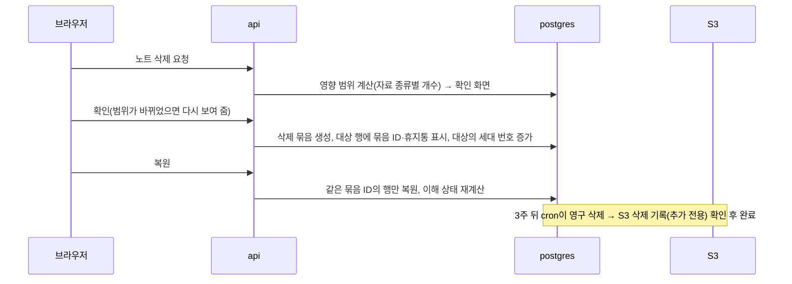

- 즉시 영구 삭제, 과목 삭제 범위(DAR-006 3), 다중 출처 문제의 문항 단위 판정(DAR-006 4)도 같은 삭제 묶음 경로로 처리한다.
- **탈퇴**: 모든 세션을 철회하고, 진행 중인 작업의 세대 번호를 올리고, 알림과 예약을 멈춘다. 7일 뒤 전체를 삭제하고 S3 삭제 기록을 30일 유지한다.

### F7. 백업과 복원

- **백업**: WAL-G가 WAL을 연속으로 보관하고 기본 백업을 매일 S3에 올린다. 시점 복구 범위는 7일, 보존 기간은 3주다(S3 수명 주기 규칙). 음성 조각은 S3에 직접 있고, 만료 시각부터 접근을 막는다.
- **복원 순서**: 격리 환경에 복원 → S3 삭제 기록 재적용([ADR-0008](adr/0008-deletion-records-outside-db.md)) → 소유권·버전·일정 검증 → 운영 반영. 삭제 기록 누락 여부를 확인할 수 없으면 반영하지 않는다.
- **Redis**: 복원하지 않는다. DB를 복원했거나 Redis 데이터만 잃었으면, 기존 Stream과 lease를 비우고 미완료 `jobs`마다 outbox 행을 다시 만들어 보낸다. 이전 실행이 아직 돌고 있어도 새 실행이 실행 시도 번호를 올리므로 이전 실행의 결과는 반영되지 않는다(ADR-0018). SSE 클라이언트는 다시 불러오기 신호를 받는다.
- **DB 복원 뒤 작업 재개**: 작업 실행을 멈춘 채 복원 → 삭제 기록 재적용 → 시퀀스를 삭제 기록의 최대 ID보다 크게 올림(schema.md 10장) → 검증 → Redis 재구성 → 실행 재개 순서다. 복원 시점 뒤에 이미 끝났던 작업이 다시 돌면 외부 호출 비용이 한 번 더 든다.
- 복원 리허설을 출시 조건에 넣는다.

## 5. 공통 패턴 (`platform`)

| 패턴 | 내용 | 근거 |
|---|---|---|
| 반영 확인 | AI 결과에 근거 (자료 ID, 버전) 목록을 붙인다. 대상별 세대 번호를 둔다. 커밋 트랜잭션에서 대상 행을 잠그고 근거 버전, 세대 번호, 실행 시도 번호, 읽었던 노트 버전을 비교한다. 근거 수정·노트 버전 변경이면 다시 계산하고, 삭제·권한 상실·취소면 끝낸다. Q&A 답변만 예외로, 근거가 수정·삭제됐으면 다시 생성하지 않고 '근거 변경됨'으로 저장한다(SFR-016 8). | [ADR-0006](adr/0006-commit-time-evidence-check.md) |
| 작업 등록 | `jobs` 행과 `outbox` 행을 도메인 변경과 같은 트랜잭션에서 넣는다. 커밋 직후 Taskiq로 보내고(작업 ID만) `sent_at`을 채운다. 회수 루프는 오래된 미전송 outbox만 다시 보낸다. 요청 식별자가 같으면 기존 작업을 돌려준다. ACK는 결과 커밋 뒤에 한다. | [ADR-0017](adr/0017-taskiq-delivery-sdk-retries.md), [ADR-0019](adr/0019-outbox-and-ack-after-commit.md) |
| 실행 권한 | Redis lease(`NX`, TTL 30초, heartbeat 10초)를 먼저 잡고 DB `jobs.attempt_no`를 올린다. 모든 결과 반영 트랜잭션은 `attempt_no`를 확인한다. Redis가 잃는 것은 중복 호출 비용일 뿐이다. | [ADR-0018](adr/0018-db-fencing-redis-lease.md) |
| 작업 재개 | Q&A는 단계 결과와 완료 표시(`messages.answer_status`·`reflect_status`·`learner_status`)를 한 트랜잭션으로 커밋하고, 재시도 때 남은 단계부터 한다. 과목 노트 업데이트는 Postgres 체크포인터로 마지막 노드부터 이어 가고, 반영 노드가 `note_updates.status`로 이중 반영을 막는다. 결과 반영 트랜잭션은 `attempt_no`를 확인한다. | [ADR-0022](adr/0022-qa-followup-stages-in-one-job.md), [ADR-0023](adr/0023-course-update-checkpointer-and-interrupt.md), SFR-043 |
| 재시도 | OpenAI SDK `max_retries`(초기값 배경 작업 2, `qa_answer` 작업의 모든 단계 1. 외부 호출 하나당 최대 4회 안, 재시도할 수 없는 오류는 바로 실패). Taskiq 재시도는 쓰지 않는다. 워커 장애 인계는 `attempt_no`가 3을 넘으면 실패로 끝낸다. 호출마다 작업 마감까지 남은 시간 안에서 timeout을 둔다. | [ADR-0017](adr/0017-taskiq-delivery-sdk-retries.md), QUR-004, SIR-002 |
| 이벤트 | 진행은 사용자별 Redis Stream에 쌓고 SSE로 보낸다. `Last-Event-ID`로 재개한다. 답변 토큰은 Stream(AOF로 디스크에 남음)이 아니라 pub/sub으로 보내고, 재접속하면 완료된 답변을 DB에서 읽는다(SER-001 4, SFR-021 4). 완료·실패·취소는 outbox를 거친다. 이벤트에 작업 ID와 실행 시도 번호를 붙인다. | [ADR-0005](adr/0005-sse-for-events-websocket-for-recording.md) |
| 비용 예약 | Postgres 예약 장부에 호출 전 예약하고 호출 뒤 정산한다. 작업 등록과 같은 트랜잭션에서 한다. 사용자 하루 1달러, 전체 하루 10달러(UTC). 작업을 끝내는 모든 경로(성공·실패·취소·인계 상한 초과)는 같은 트랜잭션에서 그 작업의 남은 예약을 정산하거나 `released`로 바꾼다. 예약은 날짜가 바뀌어도 한도에 남기 때문이다(PER-003 2). | PER-003 |
| 삭제 묶음 | 한 번의 삭제에 묶음 ID를 붙인다. 복원은 묶음 단위다. 기한이 여럿이면 가장 이른 기한에 삭제한다. | SFR-013·048, DAR-006 |
| 삭제 기록 | S3 추가 전용 버킷에 쓴다. 복원할 때 다시 적용한다. | [ADR-0008](adr/0008-deletion-records-outside-db.md) |
| 사용자 경계 | 모든 사용자 테이블에 `user_id`와 RLS 정책을 둔다. 트랜잭션마다 `SET LOCAL app.user_id`를 설정한다. 앱 DB 계정은 RLS를 우회할 수 없다. `cron`의 여러 사용자 작업만 별도 관리 계정을 쓴다. | SER-002 |
| 세션 철회 | 세션 테이블에 철회 시각을 커밋한다. `realtime`은 음성 묶음마다, `api`는 요청마다 세션을 확인한다. 철회 이벤트를 받으면 연결을 닫는다. | SFR-044 |
| 원문 보호 | 질문 원문은 대화 테이블에만 둔다. 작업 메시지, 로그, 추적 기록에는 ID만 남긴다. JSON 로그에 원문·키 필터를 공통으로 건다. | SER-001, SER-003, QUR-007 |
| 출처 검증 | AI 출력의 근거 ID와 구간 ID가 그 작업의 입력 안에 있는지 서버가 검증한다. 웹 근거는 웹 검색 도구 응답의 인용 목록에 있는 URL만 통과한다. 근거가 내용을 실제로 뒷받침하는지는 `evals/`에서 따로 잰다. | [ADR-0007](adr/0007-block-revisions-and-note-versions.md), QUR-001 |
| AI 호출 | 모든 모델 호출은 OpenAI SDK로 직접 한다. LangChain은 쓰지 않는다. Q&A 답변 생성(답변 저장까지)과 과목 노트 업데이트만 LangGraph 그래프로 만든다. Q&A의 반영·관찰 단계는 같은 작업 안의 일반 함수다(ADR-0022). Q&A 그래프는 체크포인터 없이 메모리에서만 돌고(SER-001 4), 과목 노트 업데이트 그래프만 Postgres 체크포인터와 `interrupt`를 쓴다. 외부 추적 도구(LangSmith 등)는 쓰지 않는다. | [ADR-0009](adr/0009-langgraph-graphs-with-openai-sdk.md), [ADR-0023](adr/0023-course-update-checkpointer-and-interrupt.md), COR-002 |

## 6. 데이터 모델 개요

테이블 단위 설계는 [schema.md](schema.md)에 있다.

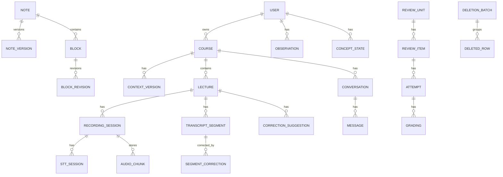

- **노트**: 강의 노트와 과목 노트는 같은 `NOTE` 구조를 쓴다. `NOTE_VERSION`은 (블록 ID, 리비전, 깊이)의 전위 순서 목록이다. 편집기 안의 블록 트리를 깊이로 펼친 것이다([ADR-0020](adr/0020-tiptap-flat-blocks-with-depth.md)). `BLOCK_REVISION`은 바꾸지 않고, 내용, 근거 목록, 작성 주체(AI·사용자·Q&A), 변경 이유를 담는다.
- **버전 계열** (DAR-002 4): STT 원본(`TRANSCRIPT_SEGMENT`), 사용자 정정(`SEGMENT_CORRECTION`), 강의 노트 편집, 과목 노트 변경을 서로 다른 계열로 둔다.
- **바꾸지 않는 기록**: 답안 원문(`ATTEMPT`)과 관찰은 바꾸지 않는다. 재평가는 새 `GRADING`과 "대체됨" 표시로 남긴다.
- **음성**: `AUDIO_CHUNK`는 S3 키와 만료 시각만 갖는다. 음성은 계정 용량 2GiB에 포함한다.
- **검색**: 노트 블록과 전사 구간을 `search_entries`에 모아, 키워드는 `pg_bigm`, 의미는 `pgvector`로 찾는다. Q&A는 두 결과를 합치고, 노트 검색 화면은 키워드 결과가 기본이다([ADR-0016](adr/0016-pgvector-with-bigm.md)).
- **운영 테이블**: `jobs`(단계, 실행 시도 번호, 실패 사유), `outbox`, AI 사용량·비용 장부, 세션, 동의 기록.

## 7. 배포와 릴리스

- **저장소**: 모노레포로 `backend/`(Python, uv, FastAPI), `frontend/`(React, Vite, TypeScript), `evals/`, `deploy/`(compose, Nginx 설정)를 둔다. FastAPI의 OpenAPI로 TypeScript 클라이언트를 생성한다. DB 접근은 SQLAlchemy ORM으로 하고 스키마의 원본은 SQL 파일이다([ADR-0021](adr/0021-sqlalchemy-mapping-only.md)).
- **노트 편집기**: Tiptap(ProseMirror)으로 직접 만든 Notion식 블록 편집기다. 블록 ID는 `@tiptap/extension-unique-id`가 UUIDv7로 붙인다([ADR-0013](adr/0013-client-generated-block-uuid.md), [ADR-0020](adr/0020-tiptap-flat-blocks-with-depth.md)).
- **배포 절차** (COR-003): 빌드 검사 → 이미지 태그(커밋 해시)로 식별 → 운영자가 수동 배포. DB 마이그레이션은 기존 버전과 호환되는 순서(확장 → 배포 → 정리)로 적용한다.
- **녹음 유지**: 새 `realtime` 컨테이너를 띄우고 `web`이 새 WebSocket만 보낸다. 옛 컨테이너는 녹음이 0개가 되면 내린다. `api`, `cron`은 바로 교체한다. `worker`는 새 작업 수신을 멈추고 유예 시간 동안 하던 작업을 마친 뒤 내린다. 남은 작업은 lease가 만료되면 새 `worker`가 인계한다.
- **S3 버킷**: `audio`(음성 조각, 만료 접근 차단은 앱이 처리), `backup`(WAL-G, 3주 수명 주기), `deletion-log`(버전 관리, 객체 잠금, 추가 전용).
- **개발 환경**은 Linux(WSL)에서 같은 compose 파일로 띄운다(COR-001 3). 특정 클라우드 API는 S3와 SES뿐이고, 둘 다 표준 인터페이스(S3 API, SMTP) 뒤에 둔다.

## 8. 품질 검증 장치

- `evals/`: 강의 노트, 과목 노트 업데이트, Q&A, 문제 생성, 채점 5개 기능 × 30건이다. 30%는 확인용으로 분리한다. 실제 서비스와 같은 프롬프트와 코드 경로로 실행한다.
- **출시 차단 자동 검사**: 출처 위조(출처 검증 결과), 다른 사용자 자료 노출(RLS 테스트), 사용자 편집 파괴, 무효 근거 사용, 미완성 답변 저장, 잘못된 전제 저장.
- **장애 주입 시험**: 커밋·전송 사이 종료, 워커 강제 종료, 커밋·ACK 사이 종료, 늦은 워커, Redis 장애·데이터 손실, 근거·편집 충돌, SSE 유실을 [testing/failure-matrix.md](testing/failure-matrix.md)대로 시험한다.
- **성능 측정** (PER-001·002·004): 동시 녹음 10개, 60분 한·영 강의, 왕복 지연 100ms 조건의 부하 스크립트로 잰다. 결과에 따라 '초기값'을 조정하고 개정 이력에 기록한다.

## 9. 요구사항 추적표

흐름 F1~F7은 4장, 패턴은 5장을 가리킨다. [후속] 항목은 구조상 들어갈 자리만 표시한다.

'지금 단계' 열은 그 요구사항을 지금 단계(`AGENTS.md`의 '지금 단계: MVP', 곧 `docs/schema-mvp.sql` 기준의 프로토타입)에서 만드는지를 `포함`, `축소: 빠지는 것`, `제외`, `미정: 이유` 가운데 하나로 적는다. 요구사항 비고의 `[MVP]`는 출시 범위라서 뜻이 다르고, `[MVP]`인 요구사항도 이 열에서는 `축소`나 `제외`일 수 있다. `미정`은 문서(`docs/schema-mvp.sql`, [schema-mvp.md](schema-mvp.md), [README.md](../README.md))로 판정할 수 없는 것이라 만들기 전에 사람에게 묻는다.

| ID | 모듈·구성 요소 | 흐름·패턴 | 지금 단계 |
|---|---|---|---|
| SFR-001 | capture · 맥락 버전 | F1 (세션 시작 시 고정), F2 | 축소: 맥락 버전 이력(`recordings.context` 고정본만) |
| SFR-002 | capture · realtime | F1 | 축소: '부분 완료' 상태와 STT 예약 시간(스키마에 없음) |
| SFR-003 | capture · realtime | F1 (의도적 정지 기록, 5분 규칙 제외) | 축소: 정지 구간 기록 |
| SFR-004 | capture · realtime | F1 (발화 단위 저장, 중복 가능, 저장 지연) | 축소: '중복 가능'·'저장 지연'·누락 구간 표시(열 없음) |
| SFR-005 | capture · realtime [후속] | F1 (언어 설정만 추가) | 제외 |
| SFR-006 | notebook · worker | F1 | 포함: `jobs.kind`의 `live_summary`. 결과는 DB에 저장하지 않는다 |
| SFR-007 | notebook · worker | F3, 반영 확인 | 축소: 노트 버전(블록 이력만) |
| SFR-008 | notebook · worker(LangGraph) | F3, 작업 재개, 실행 권한 | 축소: 연속 10분 실행 뒤 자동 일시정지(비고), 편집 잠금(5). 잠금 대신 반영 순간 판 번호를 비교한다([schema-mvp.md](schema-mvp.md) '과목 노트 업데이트 흐름') |
| SFR-009 | notebook · api | 6장 블록 리비전, 보호 블록 | 포함 |
| SFR-010 | notebook | 6장 노트 버전, 출처 숨은 속성 | 축소: 노트 전체를 이전 판으로 복원(5) |
| SFR-011 | notebook · api | 6장, 전사 위치 이동 | 포함 |
| SFR-012 | notebook [후속] | 반영 확인(출처 제외) | 제외 |
| SFR-013 | platform · account | F6, 삭제 묶음 | 축소: 삭제 범위 확인, 삭제 묶음(`deleted_at`만) |
| SFR-014 | notebook · api | 6장 노트 버전 → Markdown | 미정: 스키마와 MVP 문서에 내보내기가 나오지 않는다 |
| SFR-015 | notebook · worker | F3 (재작성 = 새 버전) | 축소: 이전 완료본의 버전 보존(블록 이력만) |
| SFR-016 | tutor · worker | F4, 반영 확인(답변은 '근거 변경됨') | 축소: 노트·전사 검색(과목 노트와 아직 반영하지 않은 강의 노트를 통째로 넣는다) |
| SFR-017 | tutor | F4 | 포함 |
| SFR-018 | tutor | F4, 출처 검증 | 포함 |
| SFR-019 | tutor · notebook | F4 (블록 ID 지정) | 포함 |
| SFR-020 | tutor · notebook | F4 (대기 20개, 적용은 notebook), 반영 확인 | 축소: 대기 뒤 재판단(5·7, `note_changes.status`에 대기 값 없음) |
| SFR-021 | tutor · api | F4 (단계별 완료 표시), 작업 재개, 이벤트 | 포함 |
| SFR-022 | notebook | F3 (강의·과목 노트 재생성 모두 `note_changes`), 6장 작성 주체 | 포함 |
| SFR-023 | platform · worker | F4 (검색 자료 갱신 작업) | 축소: 검색 자료 갱신(검색이 없다) |
| SFR-024 | learner | F4, F5 | 포함 |
| SFR-025 | learner | F5 | 포함 |
| SFR-026 | learner · tutor | F4, F5 | 포함 |
| SFR-027 | review · learner | F5 (재평가·FSRS 재계산), 6장 GRADING | 축소: 재평가 이력(새 평가 버전) |
| SFR-028 | review | F5 | 포함 |
| SFR-029 | review | F5 | 포함 |
| SFR-030 | review | F5 | 포함 |
| SFR-031 | review | F5 | 포함 |
| SFR-032 | review | F5 (FSRS 고정 버전) | 축소: 복습 단위(`review_cards` 하나가 문제와 일정을 함께 가진다) |
| SFR-033 | review | F5 | 포함 |
| SFR-034 | review · worker | F5 (출제), 반영 확인 | 축소: 문제·정답·평가 기준의 버전 |
| SFR-035 | review · worker | F5, 반영 확인 | 축소: 평가 보류(`attempts.grade_status`에 값 없음) |
| SFR-036 | review | F5 (멱등 키, 행 잠금) | 포함 |
| SFR-037 | review | F5 (절대 시각 저장, KST 표시) | 포함 |
| SFR-038 | review · cron · SES | F5 (도래 조회), 2장 cron | 축소: 메일 알림(설정 열 없음) |
| SFR-039 | review | F5 | 포함 |
| SFR-040 | review | F5 | 축소: 신규·복습 개수 설정(`users.daily_minutes`만) |
| SFR-041 | review · worker | 반영 확인 | 축소: 문제 재생성 이력 |
| SFR-042 | review | F5 | 포함 |
| SFR-043 | platform | 작업 등록, 작업 재개(과목 노트·Q&A), 재시도 | 포함 |
| SFR-044 | account · api · realtime | 세션 철회 | 포함 |
| SFR-045 | account | F6 (탈퇴), 삭제 기록 | 축소: 삭제 기록(5, DAR-007과 함께 뺀다) |
| SFR-046 | capture | F2, F3 (정정 버전, 용어 후보, STT 원본 7일 뒤 삭제) | 축소: 정정 이력·되돌리기, 녹음 중 용어 적용(3), 재전사(5) |
| SFR-047 | notebook | 6장 pg_bigm·pgvector, ADR-0016 | 제외 |
| SFR-048 | platform · account | F6 | 축소: 삭제 묶음 단위 복원(`deleted_at`만) |
| SFR-049 | notebook | F4 (되돌리기는 notebook), 6장 블록 리비전 | 포함 |
| SFR-050 | tutor · frontend | 6장 보강 블록, 안전한 표시 | 포함 |
| SFR-051 | tutor [후속] | — | 제외 |
| SFR-052 | review · api | F5 (초안 자동 저장) | 축소: 답안 초안 자동 저장 |
| SFR-053 | review | F5 | 포함 |
| SFR-054 | capture [후속] | F3 (같은 노트 생성 흐름) | 제외 |
| SFR-055 | review [후속] | — | 제외 |
| SFR-056 | review [후속] | — | 제외 |
| SFR-057 | capture [후속] | 번역문은 근거에서 제외 | 제외 |
| SFR-058 | capture · notebook | F3 (수정 제안) | 제외 |
| DAR-001 | capture · realtime · S3 | F1, 7장 버킷 | 축소: 음성 조각 기록(`recordings.audio_bytes`·`audio_expires_at`만) |
| DAR-002 | notebook · capture | 6장 버전 계열 | 축소: 노트 버전, 전사 정정 이력 |
| DAR-003 | learner | 6장 바꾸지 않는 기록 | 축소: 재평가 때 '대체됨' 표시 |
| DAR-004 | review | 6장 ATTEMPT·GRADING | 축소: 문제·평가 기준 버전, 재평가 이력 |
| DAR-005 | platform · notebook | 반영 확인(사용 시점 재확인) | 축소: 검색 자료(근거는 판 번호 비교로 확인한다) |
| DAR-006 | platform | F6, 삭제 묶음 | 축소: 삭제 묶음(`deleted_at`과 부모 경유 조회만) |
| DAR-007 | postgres · S3 · cron | F7 | 제외 |
| SER-001 | platform | 원문 보호 | 포함 |
| SER-002 | platform · postgres | 사용자 경계(RLS) | 포함 |
| SER-003 | platform | 원문 보호, 1장 | 포함 |
| SER-004 | web | 2장 HTTPS, 7장 | 미정: 운영 배포(HTTPS)를 지금 하는지 문서에 없다 |
| QUR-001 | evals | 8장, 출처 검증(웹 근거는 인용 목록) | 미정: `evals/`와 평가 세트를 지금 만드는지 문서에 없다 |
| QUR-002 | notebook · platform | F3 (DB 잠금 60초), 실행 권한, 반영 확인 | 축소: 편집 잠금(3) 없음. 반영 순간 판 번호를 비교해 다르면 반영하지 않고 보류로 표시한다(1·2) |
| QUR-003 | realtime | F1 재연결 | 축소: 중지 주체·원인 기록, 누락 구간 표시(열 없음) |
| QUR-004 | platform | 작업 등록, 실행 권한, 작업 재개, 재시도(호출당 4회 안) | 축소: 작업 인계(멈춘 작업은 실패로 끝낸다. 11-18 회의의 자동 인계는 MVP 범위 밖, [schema-mvp.md](schema-mvp.md) '작업 전달과 멈춘 작업') |
| QUR-005 | frontend | 8장 지원 환경 시험 | 미정: 지원 환경 시험을 지금 하는지 문서에 없다 |
| QUR-006 | evals | 8장 | 미정: 평가를 지금 하는지 문서에 없다 |
| QUR-007 | platform | 6장 운영 테이블, 원문 보호 | 축소: 작업 단계 기록(`job_stages`) |
| QUR-008 | frontend · realtime | F1 (브라우저 버퍼) | 축소: 누락 구간 표시(열 없음) |
| PER-001 | realtime | 8장 성능 측정 | 미정: 성능 측정을 지금 하는지 문서에 없다 |
| PER-002 | worker | 8장 성능 측정 | 미정: 성능 측정을 지금 하는지 문서에 없다 |
| PER-003 | platform | 비용 예약(작업 종료 때 정산·반환, 녹음 예약은 녹음 세션 종료 때), 2장 동시 실행 한도(사용자가 시작한 작업과 진행 중인 녹음, ADR-0022) | 포함 |
| PER-004 | tutor | F4 (호출당 입력 16k, 답변 단계 누적 64k·90초), 8장 | 미정: 입력 한도와 90초(4)는 지킨다. 응답 시간 측정을 지금 하는지는 문서에 없다 |
| PER-005 | review | F5 (조회 기반 도래) | 포함 |
| SIR-001 | capture · realtime | F1 재연결 | 축소: 누락 구간 기록, 재전사(스키마에 없음) |
| SIR-002 | platform · worker | 재시도(SDK가 `Retry-After` 준수) | 포함 |
| SIR-003 | account [후속] | — | 제외 |
| COR-001 | 전체 | 2장, 7장 | 포함 |
| COR-002 | 전체 | 2장, ADR-0001·0005·0009 | 축소: pgvector·pg_bigm 검색(4) |
| COR-003 | web · deploy | 7장, ADR-0004 | 미정: 운영 배포를 지금 하는지 문서에 없다 |
| COR-004 | capture · account | F1 이전 동의 확인 | 포함 |
| COR-005 | account | 1장 위탁 고지 | 포함 |

## 10. 미정 수치

구현·측정 전에 정할 값이다. 위 본문의 수치(lease TTL 30초, heartbeat 10초 등)는 초기값이다.

| 항목 | 정할 근거 |
|---|---|
| lease TTL·heartbeat 간격 | 장애 감지 목표 시간, 최장 GC·네트워크 정지 |
| 외부 호출 timeout | 작업·모델별 응답 시간 분포 |
| SDK `max_retries`(초기값 배경 2, Q&A 답변 1) | 장애 때 호출 수·비용, Q&A 90초 안의 재시도 여유 |
| Q&A 반영·관찰 단계 상한 시간 | 후속 단계 처리 시간 분포, '답변 정리 중' 대기 체감 |
| 워커 종료 유예 시간 | 가장 긴 단계의 처리 시간, 컨테이너 종료 설정 |
| Q&A와 배경 작업의 워커 동시 실행 수 | 계정별 한도(PER-003 5)를 지킨 부하 측정 |
| outbox 회수 기준 시간·주기 | 전달 지연과 DB 부하 측정 |
| 요청 식별자 보존 기간 | 클라이언트 재전송 창 |
| DB 복원 RPO·RTO | 복원 리허설 결과 |
