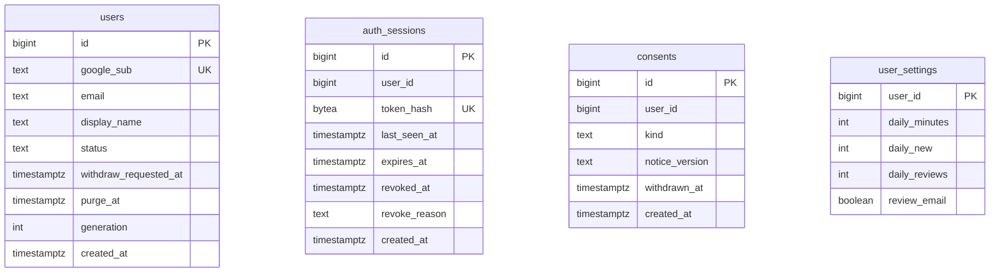
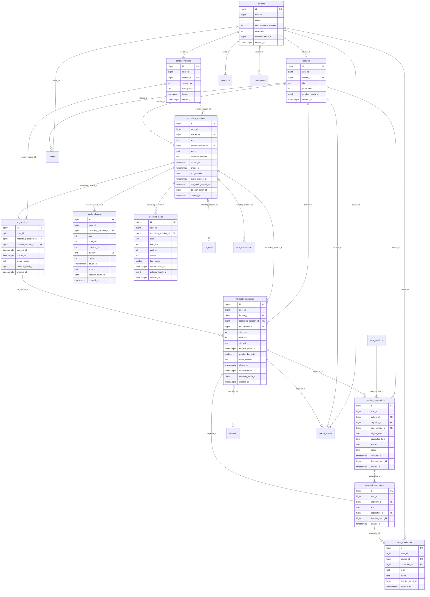
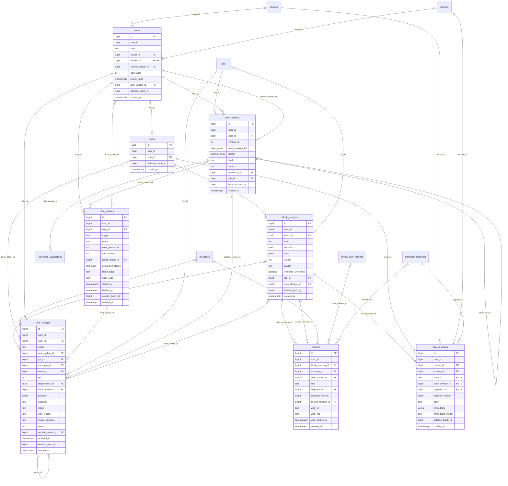
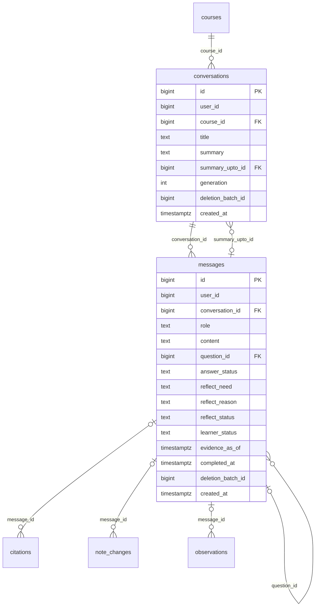
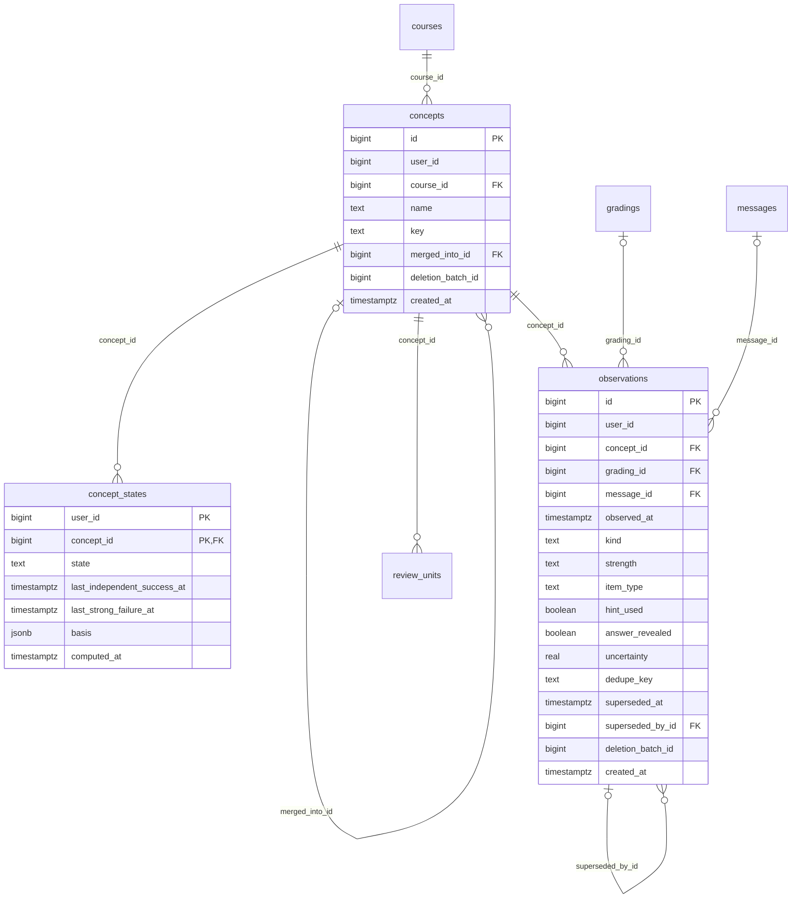
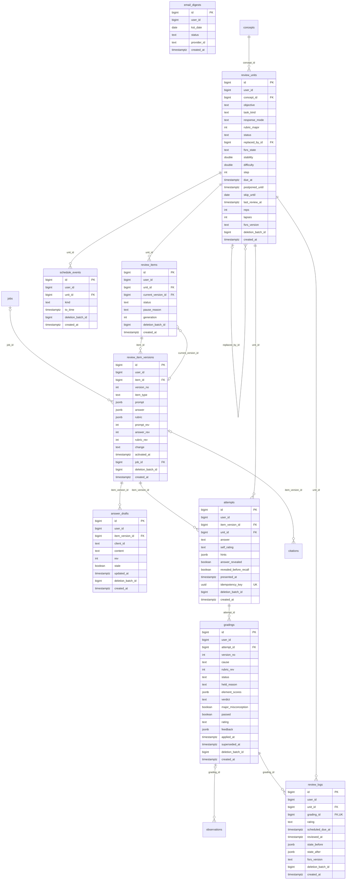
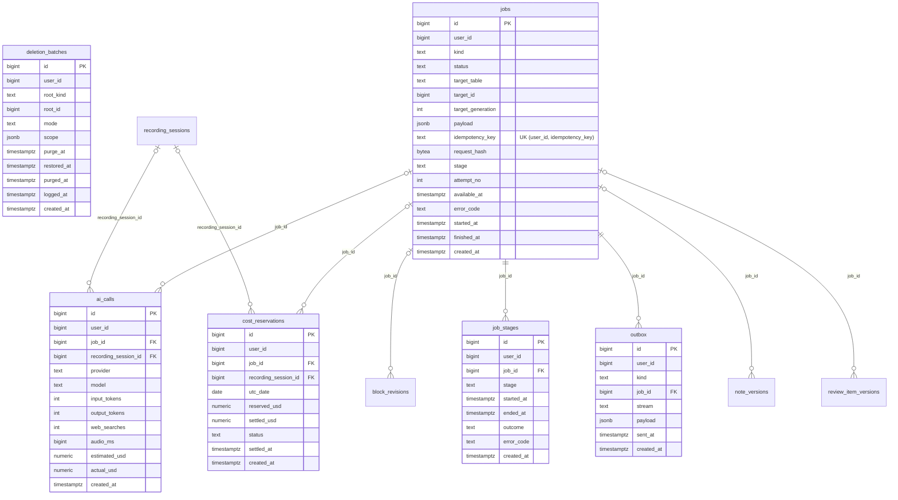

<!-- 2026-11-17 스키마(테이블 42개)를 실제 DB에 적용해 카탈로그에서 생성했다. 생성 스크립트는 남기지 않았다. 스키마를 바꾸면 이 그림도 다시 만든다. -->
<!-- 2026-11-18 손으로 고침: note_versions.depths, note_updates.completed_stages, note_changes.job_id, jobs(attempt_no·request_hash, heartbeat_at 제거), outbox 추가. 다음에 DB에서 다시 생성할 때 대조한다. -->

# Notree ERD

[schema.md](schema.md) 설계를 적용한 DB에서 생성했다. 테이블 43개(2026-11-17 생성 42개 + `outbox`), FK 115개(생성 당시 기준).

- 모든 사용자 테이블은 `user_id`로 `users`에 속하고, 부모 참조는 `(user_id, parent_id)` 복합 FK다(ADR-0010). 선은 `user_id`를 뺀 열 이름으로 표시한다.
- `deletion_batch_id`가 있는 테이블은 모두 `deletion_batches`를 참조한다(ADR-0011).
- 위 두 관계는 선이 너무 많아져서 그리지 않는다. 다른 모듈의 테이블은 열 없이 이름만 보인다.
- 선: 부모 쪽 `||`는 반드시 있음(NOT NULL FK), `|o`는 없을 수 있음(NULL 허용 FK). 자식 쪽 `o{`는 0개 이상.

## account

## capture

## notebook

## tutor

## learner

## review

## platform

