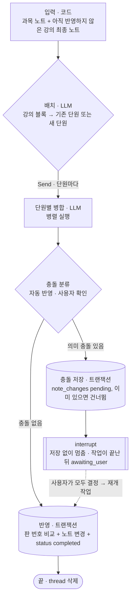
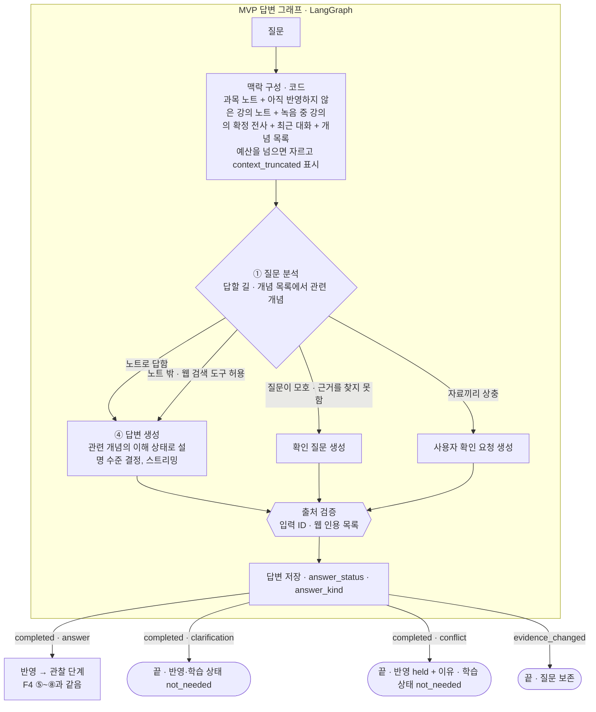

# Notree MVP 스키마

- 작성일: 2026-11-18
- SQL: [schema-mvp.sql](schema-mvp.sql)(테이블·FK·인덱스·한글 논리명), [schema-mvp-security.sql](schema-mvp-security.sql)(역할·RLS·권한)
- 바탕: 23개 테이블 안(v2, 지금은 레포에 없음)에서 핵심 흐름만 남겨 18개로 줄였다. 녹음·전사 → 노트 → Q&A로 노트 보완 → 이해 상태에 맞춘 복습. 그 뒤 `outbox`와 `note_updates`를 더해 20개다(2026-11-19).
- 논리명은 `COMMENT ON TABLE/COLUMN`에 있다. ERD 도구의 논리 뷰가 이 값을 쓴다.
- ERDCloud: [schema-mvp.erdcloud.json](schema-mvp.erdcloud.json)을 스냅샷 가져오기로 넣는다. 논리명은 한글, 물리명은 SQL 이름이다.

## ERDCloud 스냅샷 다시 만들기

SQL을 바꾸면 스냅샷도 다시 만든다. 스크립트가 DB 카탈로그에서 테이블·열·FK·COMMENT를 읽는다. 화면 배치(영역별 열)는 [scripts/erdcloud_snapshot.py](../scripts/erdcloud_snapshot.py)의 `COLUMNS`에서 바꾼다.

```bash
docker run -d --rm --name notree-mvp -e POSTGRES_PASSWORD=x postgres:17.6
docker exec -i notree-mvp psql -U postgres -q < docs/schema-mvp.sql
docker exec -i notree-mvp psql -U postgres -Atq -c "$(python3 scripts/erdcloud_snapshot.py --query)" | python3 scripts/erdcloud_snapshot.py > docs/schema-mvp.erdcloud.json
docker stop notree-mvp
```

- ID는 테이블·열 이름에서 만들어서, 다시 만들어도 바뀐 테이블만 diff에 나온다.
- 관계선은 단일 열 FK만 그린다. 관계 종류는 모두 `ZERO_OR_ONE_OR_MANY`(샘플에서 확인한 값)다.
- `CHECK`·`UNIQUE`·인덱스는 스냅샷에 담기지 않는다. 원본은 SQL이다.

## 테이블

| 영역 | 논리명 | 물리명 | 한 줄 설명 |
|---|---|---|---|
| 계정 | 사용자 | `users` | 구글 계정, 동의 시각, 하루 학습 시간, 탈퇴 상태 |
| | 로그인 세션 | `sessions` | 쿠키 해시와 만료·철회 |
| 강의 기록 | 과목 | `courses` | 과목명과 맥락(배경 설명·전문용어) |
| | 강의 | `lectures` | 과목에 속한 강의 |
| | 녹음 세션 | `recordings` | 강의 하나에 여럿. 시작 시점 맥락을 `context`에 고정 |
| | 전사 구간 | `segments` | STT 원문과 사용자 정정 |
| 노트 | 노트 | `notes` | 강의 노트(강의당 1개)·과목 노트(과목당 1개), 생성 상태 |
| | 노트 블록 | `note_blocks` | 블록의 현재 내용, 순서와 깊이, 근거, 판 번호. ID는 편집기가 만드는 UUIDv7(ADR-0013) |
| | 블록 이력 | `block_revisions` | 블록이 바뀔 때마다 한 행. 이력 조회·되돌리기 |
| | 과목 노트 업데이트 | `note_updates` | 업데이트 한 번의 상태(대기·실행·일시정지·사용자 확인 대기·완료). `id`가 체크포인트 thread |
| 질의응답 | 대화 | `conversations` | 과목별 대화 |
| | 대화 메시지 | `messages` | 질문 원문, 완료된 답변, Q&A 단계별 결과(답변·노트 반영·학습 상태 갱신) |
| | 노트 변경안 | `note_changes` | Q&A와 과목 노트 업데이트가 제안한 노트 변경, 판단할 때 본 판 번호, 처리 상태(확인 필요·수락·반영·거절·되돌림·보류) |
| 학습자 | 개념 | `concepts` | 과목별 개념과 이해 상태 |
| | 관찰 | `observations` | 이해 상태의 근거. 복습 답안 또는 Q&A에서 나온다 |
| 복습 | 복습 카드 | `review_cards` | 문제 하나와 FSRS 일정 |
| | 제출 답안 | `attempts` | 답안과 평가 결과 |
| 운영 | 작업 | `jobs` | 백그라운드 작업 상태. Redis 메시지에는 작업 ID와 `user_id`만 |
| | 보낼 작업 | `outbox` | 작업 전달을 `jobs`와 같은 트랜잭션에 기록. 회수 루프가 못 보낸 것을 다시 보낸다 |
| | 비용 장부 | `usage_ledger` | AI 비용 예약·정산 |

테이블을 소유하는 모듈은 영역을 따른다: 계정 `account`, 강의 기록 `capture`, 노트 `notebook`, 질의응답 `tutor`, 학습자 `learner`, 복습 `review`, 운영 `platform`. 예외로 `note_changes`는 표에서 질의응답 아래 있지만 `notebook`이 소유한다. `tutor`는 변경안을 제출만 한다([architecture.md](architecture.md) 3절). 표의 설명에 담지 못한 것이 셋 있다.

- `messages.question_id`가 답변을 질문에 잇는다. 재시도로 한 질문에 답변이 여럿이어도 짝이 맞는다.
- 노트는 과목마다, 강의마다 살아 있는 것이 하나다(`notes_one_course`, `notes_one_lecture`). 휴지통에 있는 노트는 자리를 차지하지 않는다.
- `jobs.user_started`는 사용자가 요청해 시작한 작업을 표시한다. 계정 동시 실행 한도가 이 작업만 센다(아래 '작업 전달과 멈춘 작업').

## v2에서 뺀 것

| v2에 있던 것 | MVP에서 | 나중에 필요해지는 때 |
|---|---|---|
| `trash_batches`, 모든 테이블의 `trash_id` | 과목·강의·노트·대화의 `deleted_at`만. 자식은 부모를 거쳐 조회 | 삭제 범위 확인 화면, 묶음 단위 복원(SFR-048) |
| `context_versions` | `courses`에 현재 맥락, `recordings.context`에 고정본 | 녹음 중 용어 즉시 적용(SFR-046 3) |
| 전사 정정 버전(`segment_corrections`) | `segments.corrected_text` 한 열 | 정정 이력, 정정 되돌리기, 전사 근거의 '갱신 필요'(아래 '근거 형식') |
| `note_versions` | 블록별 이력(`block_revisions`)만. 깊이(ADR-0020)는 `note_blocks.depth`에 둔다 | 노트 전체를 특정 판으로 복원(SFR-010 5) |
| `search_docs`(pgvector + pg_bigm) | 없음. Q&A는 과목 노트를 통째로 맥락에 넣는다(아래 'MVP Q&A 흐름') | 노트가 자주 잘릴 때, 노트 검색(SFR-047) |
| 작업 인계와 실행 시도 번호(ADR-0018) | 없음. 멈춘 작업은 실패로 끝내고 사용자가 재시도한다(아래 '작업 전달과 멈춘 작업') | 사용자 재시도 없이 이어서 끝내야 할 때 |
| 요청 식별자 `jobs.idempotency_key`(ADR-0019) | 없음. 진행 중인 Q&A의 중복 전송은 `jobs_one_qa`가, 답안 재전송은 `attempts (user_id, idempotency_key)`가 막는다 | 완료된 Q&A의 재전송 등 다른 작업의 재전송이 문제가 될 때 |
| outbox의 완료·실패·취소 이벤트(ADR-0019) | 작업 전달만 | 완료 이벤트 유실이 화면에 문제가 될 때 |
| `review_units` + `review_items` + `gradings` | `review_cards` + `attempts` | 문제 재생성 이력, 재평가 이력(DAR-004 4) |
| 전사 수정 제안, 정지 구간, 답안 초안, 작업 단계 기록(`job_stages`) | 없음 | SFR-058, SFR-003 1, SFR-052 4, QUR-007 |

## LangGraph

Q&A 그래프는 체크포인터 없이 메모리에서만 돌고(SER-001 4), 과목 노트 업데이트 그래프는 Postgres 체크포인터로 재개하며 의미 충돌은 `interrupt`로 사용자 확인을 받는다(ADR-0023). 체크포인트 테이블은 `langgraph` 스키마에 worker가 `setup()`으로 만든다.

- Q&A 그래프는 결과만 `messages`·`note_changes`·`observations`에 저장한다. 대화는 `messages`에서 최근 대화를 읽어 기억한다.
- Q&A는 ADR-0022대로 `qa_answer` 하나가 답변 → 반영 → 관찰 단계를 하고, 완료 표시는 `messages.answer_status`·`reflect_status`·`learner_status`다.
- shortcut: 대화 요약(`conversations.summary`)이 없어 최근 대화 3k보다 오래된 내용은 기억하지 못한다, 긴 대화에서 문제가 되면 목표 설계대로 요약을 넣는다.

### 과목 노트 업데이트 흐름



- **단원**: 과목 노트의 최상위 제목 블록과 다음 최상위 제목 앞까지의 블록. 그 제목 블록 ID로 식별한다. 첫 최상위 제목 앞의 블록은 '머리말' 단원 하나다. 새 단원은 배치 단계에서 서버가 UUIDv7을 미리 발급한다.
- **입력 강의**: 시작할 때 아직 반영하지 않은 강의 노트(`merged_at IS NULL OR published_at > merged_at`)를 고르고, 그 `published_at`을 그래프 상태에 둔다. 반영 노드는 같은 트랜잭션에서 그 값을 강의 노트의 `merged_at`에 쓴다. 실패한 업데이트의 강의는 `merged_at`이 그대로라 다음 업데이트에 다시 들어가고, 최종 노트를 다시 발행한 강의(SFR-007 6)는 `published_at`이 새로워져 다시 들어간다. 일부 변경이 보류된 강의도 반영된 것으로 본다. 보류는 `note_changes`에 남는다.
- **재개**: 체크포인터가 노드마다 상태(배치 계획, 끝난 단원의 병합 결과)를 저장한다. 워커가 죽으면 끝난 노드와 끝난 단원은 다시 하지 않는다. 단원 병합 동시 실행은 4개까지다(초기값).
- **이중 반영**: 부작용은 충돌 저장 노드와 반영 노드에만 있다.
  - 충돌 저장 노드는 이 `note_update_id`의 변경안이 이미 있으면 건너뛴다. 저장을 커밋한 직후, 체크포인트를 쓰기 전에 워커가 죽어 노드가 다시 돌아도 같은 충돌이 두 번 저장되지 않는다.
  - `interrupt` 노드는 아무것도 저장하지 않는다. LangGraph는 재개할 때 `interrupt()`를 부른 노드를 처음부터 다시 실행하기 때문이다.
  - 반영 노드는 노트 변경과 `note_updates.status = 'completed'`를 한 트랜잭션으로 커밋하고, 이미 `completed`면 건너뛴다.
- **사용자 확인 대기**: 그래프가 interrupt로 멈춰 실행이 돌아오면(체크포인트가 저장된 뒤) 처리 함수가 `job_tx`에서 `status = 'awaiting_user'`를 쓰고 같은 트랜잭션에서 `complete_job`으로 작업을 끝낸다. 그래프 안에서 쓰지 않는 까닭은, 체크포인트가 저장되기 전에 화면이 결정을 받아 재개하면 이어 갈 interrupt가 없기 때문이다. 화면은 `awaiting_user`일 때만 `note_changes(status='pending', note_update_id)`를 보여 준다. 사용자는 충돌마다 수락(`accepted`)하거나 거절(`rejected`)한다. 결정 API는 `note_updates` 행을 `FOR UPDATE`로 먼저 잠그고, 결정 저장(`UPDATE ... WHERE status = 'pending'`), 그 `note_update_id`의 `pending` 개수 세기, 0개면 `note_updates`를 `running`으로 바꾸고 같은 `note_updates.id`로 `course_update` 작업을 등록하는 일까지 한 트랜잭션에서 한다. 남은 `pending`을 세고 등록하는 것은 결정 저장이 실제로 행을 바꾼 요청뿐이다. 그래서 마지막 두 개를 동시에 결정해도, 마지막 결정을 다시 보내도 재개 작업은 한 번만 들어간다. 대기 중인 재개 작업이 둘이 되는 일은 `jobs_one_course_update`도 막는다. 이 인덱스는 실행 중인 작업은 막지 않는다. `awaiting_user`를 커밋한 기존 작업이 아직 `succeeded`로 바뀌기 전에 마지막 결정이 들어와도 재개는 등록돼야 하기 때문이다. worker는 아래 '재개 방법'대로 이어 간다. 반영 노드는 결정을 체크포인트가 아니라 `note_changes`에서 읽어, `accepted`를 반영하고 `applied`로 바꾼다. `rejected`는 기존 블록을 그대로 둔다.
- **판 번호 비교** (QUR-002): MVP에는 편집 잠금이 없어서 업데이트 도중에도 사용자가 과목 노트를 고칠 수 있다. 그래서 병합 단계가 읽은 블록의 `revision`을 그래프 상태에 두고, 충돌로 저장할 때는 `note_changes.base_revision`에 둔다. 반영 노드는 바꿀 블록마다 이 값을 지금의 `revision`과 비교한다. 다르면 그 변경은 반영하지 않고 `note_changes(status='held', held_reason='block_changed')`로 남긴다. 대상 블록에 `deleted_at`이 있으면 `held_reason='block_deleted'`로 남긴다. 화면은 `block_changed` 보류 항목에 AI 제안과 지금 블록을 함께 보여 주고, 사용자가 [제안대로 반영]을 누르면 화면이 본 블록의 `revision`을 함께 보낸다. api는 그 값이 지금 `revision`과 같을 때만 반영하고, 다르면 거절해 화면을 새로 고치게 한다. Q&A 변경안을 반영할 때도 같은 비교를 한다(SFR-020 2).
- **근거 재확인** (SFR-020 2, ADR-0006): 반영이나 답변·채점 결과 저장 트랜잭션은 근거로 쓴 블록과 그 상위 행을 `FOR SHARE`로 잠근 뒤 블록의 `revision`과 각 행의 `deleted_at`을 다시 비교한다. 블록 근거는 과목 → 강의 → 노트 → 블록, 전사 근거는 과목 → 강의 → 녹음 순서로 잠근다. 위에서 아래로 잠가 교착을 줄인다. 휴지통 이동은 상위 행의 `UPDATE`라 이 잠금과 경합하므로, 확인과 저장 사이에 근거가 바뀌거나 지워지지 않는다. `FOR KEY SHARE`로는 막히지 않는다. 키가 아닌 열(`deleted_at`)만 바꾸는 `UPDATE`와는 충돌하지 않기 때문이다.
- shortcut: 판 번호가 달라 보류된 변경은 사용자가 직접 메운다, 보류가 자주 생기면 그 단원만 지금 블록으로 다시 병합한다.
- **기다리는 동안**: Q&A 반영은 '과목 노트 업데이트 중'으로 대기한다(과목 노트당 20개, SFR-020 5). 새 강의는 `queued` 행 하나에 합쳐 진행 중인 업데이트가 끝난 뒤 돈다.
- **일시정지·취소** (SFR-008 6): 일시정지는 노드 사이에서 `paused`를 확인해 멈추고 같은 thread로 이어 간다. 취소는 `cancelled`로 바꾸고 thread를 지운다. 늦게 끝난 결과는 반영 노드가 상태를 보고 버린다.
- **실패와 재시도** (SFR-043 2, SFR-008 비고): 처리 함수가 예외를 내거나 회수 루프가 오래 `running`인 작업을 끝내면, `notebook`의 `@on_failure("course_update")`가 진행 중인 `note_updates`를 `failed`로 바꾼다. thread는 지우지 않는다. `failed`는 끝이 아니라 '실패 후 재개 대기'라 `note_updates_one_open`에 들어 있고, 그동안 대기 요청(`queued`)은 시작하지 않는다. 사용자는 [재시도]나 [취소]를 고른다.
  - 재시도: 재시도 API는 `note_updates` 행을 `FOR UPDATE`로 잠그고 `failed`인지 확인한 뒤, 같은 트랜잭션에서 `failed → running`으로 바꾸고 `finished_at`을 비우고 같은 `note_updates.id`로 새 `course_update` 작업을 넣는다. 연타한 두 번째 요청은 `running`을 보고 막힌다. 워커가 작업을 가져갔는지와 상관없다. 워커는 같은 thread를 아래 '재개 방법'대로 이어 간다.
  - 재개를 등록하는 트랜잭션(마지막 결정, 재시도)이 `note_updates`를 `running`으로 바꾼다. 그래서 `running`은 '실행 중이거나 실행을 요청함'이다. 등록한 작업이 시작 전에 실패하면 실패 훅이 다시 `failed`로 바꾸고, 메시지를 잃으면 회수 루프가 다시 보낸다. 끝난 단원은 다시 병합하지 않는다. 멈춘 줄 알았던 옛 실행이 늦게 체크포인트를 써도 데이터는 반영 노드의 `completed` 확인이 지키고, LLM 단계를 한 번 더 할 뿐이다.
  - 취소: `cancelled`로 바꾸고 thread를 지운다. 대기 요청이 시작되고, `merged_at`이 그대로인 실패한 강의도 그 업데이트에 들어간다.
- **재개 방법**: 재개·재시도 작업은 thread 상태를 보고 시작 방법을 고른다. 남은 interrupt가 있고 그 업데이트에 `pending` 변경안이 남아 있으면 재개하지 않고 `running → awaiting_user`로 되살린 뒤 끝낸다. interrupt 체크포인트를 저장한 뒤 `awaiting_user`를 쓰기 전에 워커가 죽어 `failed`가 된 경우다. 남은 interrupt가 있고 `pending`이 0개면 `Command(resume=...)`로 이어 간다. 결정은 resume 값이 아니라 `note_changes`에서 읽는다. interrupt 없이 체크포인트만 있으면 `None`으로 마지막 체크포인트부터 이어 가고, 체크포인트가 없으면 처음부터 한다. 마지막 결정을 저장한 직후 재개 워커가 죽어 `failed`가 된 경우에도, 재시도는 남은 interrupt를 보고 저장된 결정으로 같은 thread를 이어 간다.
- **thread 정리** (ADR-0023): 완료·취소 때 워커가 thread를 지운다. 실패한 thread는 재시도·취소·노트 삭제까지 남긴다. cron이 하루 한 번 `note_updates` 행이 없거나 `completed`·`cancelled`인 thread를 지운다. 지운 직후 늦게 끝난 노드가 체크포인트를 다시 써서 되살아난 thread도 여기서 정리된다.
- shortcut: 연속 10분 실행 뒤 자동 일시정지가 없어서 30분 넘게 걸리는 정상 업데이트도 회수 루프가 `stalled`로 끝낸다, 업데이트가 길어지면 자동 일시정지를 넣는다.

### MVP Q&A 흐름

목표 설계([architecture.md](architecture.md) F4)와 골격은 같고, 검색(②)과 충분성 판단(③) 대신 맥락 구성을 둔다. 저장 뒤 반영·관찰 단계는 F4 ⑤~⑧과 같다.



- **맥락**: 과목 노트, 강의 자료, 최근 대화, 과목의 개념 목록(이름·이해 상태)을 넣는다(SFR-016 3, SFR-026 1). 강의 자료는 그 과목에서 녹음 중인 강의의 확정 전사 구간(최근 구간부터)과 아직 과목 노트에 반영하지 않은 강의 노트(위 '입력 강의'와 같은 기준, 최근 강의부터)이고, 이 순서로 합계 4k까지 넣는다(PER-004 4의 '지정 자료' 몫). 최근 대화에서 근거가 '갱신 필요'나 '출처 삭제됨'인 과거 답변은 본문을 빼고 질문만 넣는다(SFR-016 7). 전사를 근거로 쓰면 `sources`에 `{segment_id}`를 남기고, 화면의 기준 시각은 인용한 구간 가운데 가장 늦은 시각이다.
- **예산**: 호출당 입력 16k(PER-004 4). 넣는 항목은 모두 이 하나의 예산에서 뺀다. 시스템 1.5k, 질문 2k, 최근 대화 3k, 강의 자료 4k, 개념 목록 1.5k(대화 요약이 없어 '요약' 몫을 쓴다)가 상한이고, 과목 노트는 이들이 실제로 쓰고 남은 몫을 다 쓴다. 다른 항목이 모두 차도 4k가 남는다('검색' 몫). 넘으면 최근에 갱신된 블록부터 담고 원래 순서로 다시 정렬하며, `messages.context_truncated`를 켠다. 호출이 질문 분석·답변 생성 두 번이라 누적 64k에는 닿지 않는다.
- **개념**: ①은 맥락의 개념 목록 안에서만 관련 개념을 고른다. 이름을 지어내면 DB의 개념과 맞지 않아 이해 상태를 못 읽기 때문이다.
- **확인 질문** (SFR-016 4): 질문이 모호하거나, 맥락에 근거가 없고 웹 검색도 쓸 수 없으면 ①이 확인 질문으로 보낸다. 웹 검색까지 했는데 근거가 없으면 ④가 근거가 없다고 답변에 표시한다.
- **상한**: 90초를 넘기면 `answer_status = 'failed'`로 저장하고 본문은 남기지 않는다(SFR-021 3). 출력 토큰 한도에 걸리면 `completed`로 저장하고 `output_truncated`를 켠다. 끊긴 답변은 학습 증거로 쓰지 않으므로 관찰 단계를 건너뛰고 `learner_status = 'not_needed'`로 둔다(11-18 회의 결정).
- **시간 예산** (ADR-0022): 답변 단계 90초, 반영·관찰 단계 합계 30초다. 이 시간은 SDK 재시도와 그 대기를 포함한 단계 전체의 마감이다. 처리 함수가 단계마다 마감을 두고(`asyncio.timeout`), 각 호출의 timeout은 그 단계에 남은 시간으로 정한다. `qa_answer` 작업의 AI 호출은 모두 재시도 1회(`ai_client(qa_answer=True)`)다. 합계 120초가 회수 루프의 Q&A 기준(`STALLED_QA` 3분)보다 짧아야 정상 Q&A가 `stalled`로 끝나지 않는다. 마감을 넘긴 단계와 그 뒤 단계만 `failed`가 된다. 이미 끝난 단계의 결과와 완료 표시는 그대로다.
- **재시도** (SFR-021 3, SFR-043 2): 답변 단계가 실패했으면 저장된 질문으로 새 답변 메시지를 만든다. 답변이 `completed`이고 반영·관찰 단계만 실패했으면 같은 답변 메시지를 대상으로 새 `qa_answer` 작업을 넣고, 완료 표시가 없는 단계만 다시 한다. 반영이 성공하고 관찰만 실패했으면 관찰만 한다.
- **답변 토큰** (SER-001 4): 스트리밍 중인 답변 토큰은 Redis pub/sub으로 보낸다. 이벤트 Stream은 AOF로 디스크에 남기 때문이다. 완료·실패 같은 이벤트만 Stream에 둔다.
- **출처 검증**: 입력에 없는 근거 ID와 인용 목록에 없는 URL은 버리고, 답변은 저장한다(ADR-0007).
- shortcut: 개념 목록이 1.5k를 넘으면 자르고, 강의 자료가 4k를 넘으면 오래된 것부터 뺀다, 문제가 되면 `search_docs`를 넣는다.

## 작업 전달과 멈춘 작업

아래 함수는 `backend/notree/platform`의 `jobs`, `sweeper`, `usage`에 있다. 쓰는 법은 [README.md](../README.md) '모듈에 코드 넣기'에 있다.

- **전달**: `enqueue(db, kind, target_id=None, *, user_started=False)`는 `jobs` 행과 `outbox` 행을 부른 쪽의 트랜잭션에 넣고, 커밋 직후 Redis로 보내 `sent_at`을 채운다. 커밋 뒤 보내기 전에 죽으면 회수 루프가 `sent_at IS NULL`인 오래된 행을 다시 보낸다(ADR-0019). 보냈는데도 5분 넘게 `queued`인 작업은 Redis에서 메시지를 잃은 것으로 보고 다시 보낸다. 같은 작업이 두 번 와도 워커는 `status = 'queued'`인 작업만 가져가므로 한 번만 돈다.
- shortcut: 완료된 Q&A를 클라이언트가 다시 보내면 새 질문이 생긴다, 중복 질문이 문제가 되면 질문 메시지에 클라이언트가 만든 ID를 붙인다.
- **계정 동시 실행 한도** (PER-003 5, ADR-0022): 사용자가 요청해 시작하는 작업은 `user_started=True`로 등록한다. 이때 `enqueue`가 `user_started_count(db)`로 `users` 행을 잠그고 그 계정의 끝나지 않은 사용자 시작 작업과 진행 중인 녹음을 더해 센다. 녹음 수는 `platform`이 `recordings`를 직접 읽지 않고, capture가 `db.py`에서 `@counts_toward_limit`로 등록한 함수가 센다. 녹음도 사용자가 시작한 작업이라 한도에 든다. 녹음 시작 API도 같은 트랜잭션에서 `user_started_count`를 보고 2 이상이면 막는다. 합계가 이미 2개이거나, Q&A를 등록하는데 Q&A가 이미 1개 있으면 `ConcurrencyLimit`을 낸다. Q&A 1개는 유니크 인덱스 `jobs_one_qa`도 막는다. 시스템이 이어서 만드는 작업은 `user_started` 없이 등록하고, 한도에 세지 않는다.
- **회수 루프**: `sweep_once()`가 worker 프로세스 안에서 30초마다 돈다. 한 번 돌 때 보내지 못한 작업 전달을 다시 보내고, 멈춘 작업을 실패로 끝낸다. 여러 사용자의 행을 훑으므로 `SECURITY DEFINER` 함수 `unsent_outbox`·`stalled_jobs`로 찾고(ADR-0010), 멈춘 작업은 작업마다 `user_tx`에서 `fail_job`으로 끝낸다.
- **멈춘 작업**: MVP는 인계를 하지 않는다. 11-18 회의의 자동 인계(정상 워커가 1분 안에 이어받음)는 MVP 범위 밖으로 정했다(2026-11-19). 같은 행을 다시 `running`으로 만들려면 heartbeat와 `attempt_no` 비교(ADR-0018)가 함께 있어야 늦은 저장을 막을 수 있어서다. 대신 회수 루프가 `running`인 채 오래된 작업(초기값 Q&A 3분, 배경 작업 30분)을 `failed`(`error_code = 'stalled'`)로 끝내고 비용 예약을 푼다. 그러지 않으면 작업이 영원히 `running`으로 남아 계정당 Q&A 1개 한도와 비용 예약을 계속 잡는다. 사용자는 '생성 실패'를 보고 재시도한다(SFR-021 3, SFR-043). 재시도는 새 `jobs` 행으로 한다. 실패한 행을 다시 `running`으로 바꾸면 늦게 깨어난 워커가 아래 `job_tx`의 확인을 통과한다. 무엇을 다시 하는지는 작업마다 다르다(Q&A는 위 'MVP Q&A 흐름'의 재시도, 과목 노트 업데이트는 위 '실패와 재시도').
- **실패 훅**: 작업이 실패로 끝나면(처리 함수의 예외, 회수 루프의 stalled 처리) `platform`의 `fail_job(db, job_id, error_code)`이 `jobs`를 `failed`로 바꾸고, 예약을 풀고, 그 작업 종류에 `@on_failure(kind)`로 등록된 함수 `hook(db, job)`을 **같은 트랜잭션에서** 부른다. 모듈은 거기서 자기 도메인 행(`messages.answer_status`, `notes.status`, `note_updates.status`, `attempts.grade_status`)을 실패로 바꾼다. `platform`은 모듈을 import할 수 없어서 훅으로 한다. 한 트랜잭션이라 중간에 죽거나 훅이 예외를 내면 전체가 롤백되고, 작업은 `running`으로 남아 회수 루프가 다시 끝낸다. 훅이 없으면 `jobs`만 `failed`가 되고 화면에는 계속 '생성 중'이 남아서, 사용자가 '생성 실패'를 보고 재시도할 수 없다. 회수 루프는 결과 저장을 마친 작업도 실패로 끝낼 수 있으므로, 훅은 아직 진행 중인 행만 바꾼다.
- **오류 로그** (SER-001 2): 작업 오류는 작업 ID, 종류, 예외 클래스 이름만 남긴다. 예외 메시지와 traceback의 값에는 원문이 섞일 수 있다.
- **작업 종료와 후속 등록**: 처리 함수가 반환된 뒤 `run_job`이 작업을 `succeeded`로 바꾸므로, 그 사이에 시작한 같은 대상의 다음 작업은 이 작업을 아직 `running`으로 본다. 후속 작업을 등록하거나 다음 단계를 여는 처리 함수는 마지막 저장 `job_tx` 안에서 `complete_job(db, job)`을 불러 작업 종료와 함께 커밋한다(실시간 요약의 후속 등록, 과목 노트의 `awaiting_user`).
- **늦은 저장 막기**: 처리 함수는 결과를 `job_tx(job)` 안에서 저장한다. `job_tx`는 그 작업이 아직 `running`인지 확인하고, 아니면 `JobNotRunning`을 내서 저장하지 않는다. 다시 실행하는 쪽이 없으므로 이 확인만으로 실패 처리 뒤 깨어난 워커의 저장을 막는다. 인계를 넣을 때는 ADR-0018의 `attempt_no`로 바꾼다.
- **비용 예약**: AI 호출 전에 `reserve(db, usd, *, provider="openai", job_id=None)`로 예약하고, 호출 뒤에 `settle(db, ledger_id, cost_usd)`로 정산한다. 하루 한도(PER-003 2)를 넘으면 `reserve`가 `BudgetExceeded`를 낸다. `job_id`를 준 예약 가운데 정산하지 못하고 남은 것은 작업을 끝내는 경로(성공, 실패, stalled 처리)가 푼다(`release_job(db, job_id)`). 예약은 날짜가 바뀌어도 한도에 남기 때문이다.
- **녹음 비용 예약** (PER-003 3): STT 예약은 작업이 아니라 녹음 세션에 묶는다(`usage_ledger.recording_id`). realtime은 진행 중인 녹음의 `recordings.last_seen_at`을 30초마다 갱신한다. 녹음이 정상으로 끝나면 realtime이, realtime이 죽어 `last_seen_at`이 5분 넘게 멈추면 회수 루프가 녹음을 끝내고(DAR-001 4) 같은 정산·해제 함수로 그 녹음의 예약을 정산하거나 푼다. 코드는 capture를 구현할 때 만든다.

## 근거 형식

`note_blocks.sources`, `block_revisions.sources`, `messages.sources`, `review_cards.sources`가 같은 형식을 쓴다.

- **형식**: `[{segment_id} | {block_id, revision} | {url, fetched_at}]`. 항목 하나가 전사 구간, 노트 블록, 웹 주소 가운데 하나를 가리킨다. `revision`은 인용한 순간 그 블록의 `note_blocks.revision`이고, `fetched_at`은 웹 검색을 한 조회 시각이다(SFR-010 1). `review_cards.sources`에는 `{block_id, revision}`만 온다.
- **검증**: AI는 ID와 URL만 낸다. 서버가 `platform.sources.verify_sources(sources, *, segment_ids, block_revisions, urls)`로 그 작업의 입력에 있던 근거만 통과시키고, 블록에는 입력의 판 번호를, 웹 근거에는 입력의 조회 시각을 붙여 저장 형식으로 돌려준다(ADR-0007). 통과하지 못한 근거는 버린다. `urls`에는 웹 검색 도구 응답의 인용 목록을 조회 시각과 함께 넘긴다.
- **'갱신 필요'와 '출처 삭제됨'**: 저장하지 않고 조회할 때 구한다(ADR-0012). 인용한 `revision`이 그 블록의 현재 `revision`과 다르면 '갱신 필요'이고, 블록이 없거나 `deleted_at`이 있으면 '출처 삭제됨'이다. 블록 자신의 근거가 '갱신 필요'나 '출처 삭제됨'이어도 그 블록은 '갱신 필요'다(SFR-008 3).
- **복습 카드의 근거** (SFR-041, SFR-023): 카드를 보여 주거나 채점할 때 두 단계를 본다. 카드가 인용한 과목 블록의 `revision`이 그대로인지, 그리고 그 블록이 위 기준으로 '갱신 필요'가 아닌지다. 강의 블록이 바뀌면 과목 블록의 `revision`은 그대로여도 카드가 멈춘다. 직접 편집·Q&A 반영·되돌리기도 모두 블록의 `revision`을 올리므로 따로 재검토를 등록하지 않아도 같은 비교로 걸린다.
- **무효 카드 재생성** (SFR-041 3): 카드를 보여 줄 때 무효를 발견하면 그 카드는 빼고 `generate_card`(대상: 과목 노트)를 등록한다. 대기는 과목 노트당 1개다(`jobs_generate_card_queued`, 유니크 위반이면 이미 등록된 것으로 본다). 처리 함수는 무효 카드를 갱신하거나 다시 만들고, 카드가 없는 새 블록에 카드를 만든다. 과목 노트 업데이트가 끝났을 때도 같은 작업을 등록한다.
- 수용 테스트(review 구현 PR이 먼저 둔다): 직접 편집으로 근거 블록이 바뀐 카드는 제공에서 빠지고, `generate_card`가 끝나면 새 근거 판으로 다시 만들어져 제공된다.
- **이력의 근거**: `block_revisions`에도 그 판의 근거를 둔다. 블록을 되돌릴 때 내용과 근거가 함께 돌아와야 해서다.
- shortcut: 전사 구간에는 버전이 없어 전사 정정으로 생기는 '갱신 필요'는 판정하지 못한다. 정정 버전을 넣을 때 `{segment_id, version}`으로 넓힌다.

## 노트에서 개념과 복습 카드까지

- 과목 노트 업데이트가 완료되면 `notebook`이 `enqueue("generate_card", target_id=과목 노트 ID)`로 알린다. `notebook`은 `review`를 부를 수 없어서 작업으로 넘긴다([architecture.md](architecture.md) 3절).
- `review`의 `generate_card` 처리 함수가 과목 노트 블록을 `notebook`의 공개 함수로 읽고, 블록에서 뽑은 개념을 `learner`의 공개 함수로 `concepts (course_id, key)`에 UPSERT한 뒤, 개념마다 복습 카드(`review_cards`)를 만든다. 카드의 근거는 `{block_id, revision}`이다(위 '근거 형식').
- 개념은 이 작업이 만든다. Q&A는 개념을 만들지 않고 있는 목록에서만 고른다(위 'MVP Q&A 흐름').
- 개념 추출과 출제를 한 호출로 할지, 어떤 블록과 개념을 고를지는 `review`에서 정한다(SFR-028~034). 흐름 그림은 [architecture.md](architecture.md) F5에 있다.
- **이해 상태 갱신** (SFR-025): `learner`는 관찰을 저장하고 상태를 다시 계산할 때 그 `concepts` 행을 `FOR UPDATE`로 잠근다. 서로 다른 카드가 같은 개념을 가리켜도 두 채점이 상태를 덮어쓰지 않는다. 채점은 `attempts.hint_used`와 `answer_revealed`(제출 전 정답 보기, SFR-052 6)를 반영한다. 90일 경과(SFR-025 3)는 저장된 상태를 바꾸지 않고 읽을 때 계산한다. 마지막 독립 성공에서 90일이 지난 '독립 수행 확인'은 '재확인 필요'로 읽는다. Q&A와 복습이 같은 읽기 함수를 쓴다. 다시 계산할 때는 관찰 이력을 시간순으로 다시 따라가며 각 관찰 시점마다 90일 만료를 먼저 적용한다. 그래서 만료 뒤 첫 성공은 '재확인 필요'에서 출발해 세고, 서로 다른 날 두 번 성공해야 복구된다. 관찰은 바꾸지 않는 기록이라 언제든 같은 결과로 다시 계산된다.
- 수용 테스트(learner 구현 PR이 먼저 둔다): '독립 수행 확인' 뒤 90일이 지나고 첫 독립 성공 한 번으로는 '재확인 필요'가 유지되고, 다른 날 두 번째 성공에서 '독립 수행 확인'이 된다.

## 보안

- 모든 사용자 테이블에 `user_id` + RLS(`sessions` 제외). 자식 테이블의 `user_id`는 관계가 아니라 RLS용 복사본이라 `users`로 FK를 걸지 않는다. 소유는 부모 FK 체인(과목 → 사용자)으로 이어진다.
- `jobs`도 RLS를 받는다. 워커는 사용자를 모르면 작업 행을 읽지 못하므로, 작업 메시지에 작업 ID와 `user_id`를 함께 싣고 워커가 그 값으로 `SET LOCAL app.user_id`를 한다. 여러 사용자의 작업을 훑는 회수 루프(위 '작업 전달과 멈춘 작업')는 `SECURITY DEFINER` 함수 `unsent_outbox`·`stalled_jobs`로 찾는다(ADR-0010).
- 앱 계정은 `users`·`block_revisions`·`observations`·`usage_ledger`를 지울 수 없고, `block_revisions`·`observations`는 고칠 수도 없다. 영구 삭제는 cron(`notree_admin`)만 한다.
- FK는 단일 열이라 자식의 `user_id`가 부모와 같은지 DB가 확인하지 않는다. 자식은 부모를 RLS로 걸러 읽는 `INSERT ... SELECT ... FROM <부모> WHERE id = $1`로 만든다. 남의 부모 ID면 0행이 들어가고, `user_id`도 부모에서 복사된다.
