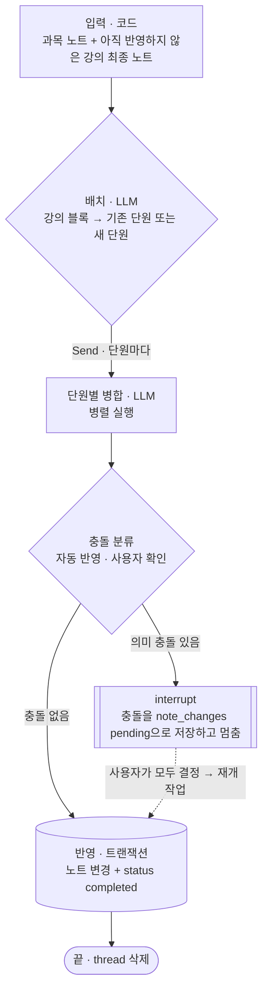
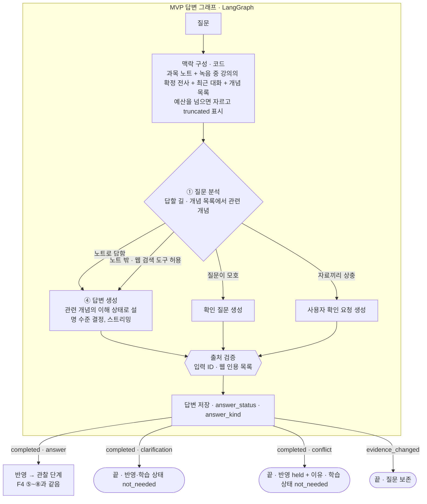

# Notree MVP 스키마

- 작성일: 2026-11-18
- SQL: [schema-mvp.sql](schema-mvp.sql)(테이블·FK·인덱스·한글 논리명), [schema-mvp-security.sql](schema-mvp-security.sql)(역할·RLS·권한)
- 바탕: 23개 테이블 안(v2, 지금은 레포에 없음)에서 핵심 흐름만 남겨 18개로 줄였다. 녹음·전사 → 노트 → Q&A로 노트 보완 → 이해 상태에 맞춘 복습. 그 뒤 `outbox`와 `note_updates`를 더해 20개다(2026-11-19).
- 논리명은 `COMMENT ON TABLE/COLUMN`에 있다. ERD 도구의 논리 뷰가 이 값을 쓴다.
- ERDCloud: [schema-mvp.erdcloud.json](schema-mvp.erdcloud.json)을 스냅샷 가져오기로 넣는다. 논리명은 한글, 물리명은 SQL 이름이다.

## ERDCloud 스냅샷 다시 만들기

SQL을 바꾸면 스냅샷도 다시 만든다. 스크립트가 DB 카탈로그에서 테이블·열·FK·COMMENT를 읽는다. 화면 배치(영역별 열)는 [scripts/erdcloud_snapshot.py](../scripts/erdcloud_snapshot.py)의 `COLUMNS`에서 바꾼다.

```bash
docker run -d --rm --name notree-mvp -e POSTGRES_PASSWORD=x postgres:17.6
docker exec -i notree-mvp psql -U postgres -q < docs/schema-mvp.sql
docker exec -i notree-mvp psql -U postgres -Atq -c "$(python3 scripts/erdcloud_snapshot.py --query)" | python3 scripts/erdcloud_snapshot.py > docs/schema-mvp.erdcloud.json
docker stop notree-mvp
```

- ID는 테이블·열 이름에서 만들어서, 다시 만들어도 바뀐 테이블만 diff에 나온다.
- 관계선은 단일 열 FK만 그린다. 관계 종류는 모두 `ZERO_OR_ONE_OR_MANY`(샘플에서 확인한 값)다.
- `CHECK`·`UNIQUE`·인덱스는 스냅샷에 담기지 않는다. 원본은 SQL이다.

## 테이블

| 영역 | 논리명 | 물리명 | 한 줄 설명 |
|---|---|---|---|
| 계정 | 사용자 | `users` | 구글 계정, 동의 시각, 하루 학습 시간, 탈퇴 상태 |
| | 로그인 세션 | `sessions` | 쿠키 해시와 만료·철회 |
| 강의 기록 | 과목 | `courses` | 과목명과 맥락(배경 설명·전문용어) |
| | 강의 | `lectures` | 과목에 속한 강의 |
| | 녹음 세션 | `recordings` | 강의 하나에 여럿. 시작 시점 맥락을 `context`에 고정 |
| | 전사 구간 | `segments` | STT 원문과 사용자 정정 |
| 노트 | 노트 | `notes` | 강의 노트(강의당 1개)·과목 노트(과목당 1개), 생성 상태 |
| | 노트 블록 | `note_blocks` | 블록의 현재 내용, 순서와 깊이, 근거, 판 번호. ID는 편집기가 만드는 UUIDv7(ADR-0013) |
| | 블록 이력 | `block_revisions` | 블록이 바뀔 때마다 한 행. 이력 조회·되돌리기 |
| | 과목 노트 업데이트 | `note_updates` | 업데이트 한 번의 상태(대기·실행·일시정지·사용자 확인 대기·완료). `id`가 체크포인트 thread |
| 질의응답 | 대화 | `conversations` | 과목별 대화 |
| | 대화 메시지 | `messages` | 질문 원문, 완료된 답변, Q&A 단계별 결과(답변·노트 반영·학습 상태 갱신) |
| | 노트 변경안 | `note_changes` | Q&A가 제안한 노트 변경과 처리 상태(확인 필요·반영·거절·되돌림·보류) |
| 학습자 | 개념 | `concepts` | 과목별 개념과 이해 상태 |
| | 관찰 | `observations` | 이해 상태의 근거. 복습 답안 또는 Q&A에서 나온다 |
| 복습 | 복습 카드 | `review_cards` | 문제 하나와 FSRS 일정 |
| | 제출 답안 | `attempts` | 답안과 평가 결과 |
| 운영 | 작업 | `jobs` | 백그라운드 작업 상태. Redis 메시지에는 작업 ID와 `user_id`만 |
| | 보낼 작업 | `outbox` | 작업 전달을 `jobs`와 같은 트랜잭션에 기록. 회수 루프가 못 보낸 것을 다시 보낸다 |
| | 비용 장부 | `usage_ledger` | AI 비용 예약·정산 |

## v2에서 뺀 것

| v2에 있던 것 | MVP에서 | 나중에 필요해지는 때 |
|---|---|---|
| `trash_batches`, 모든 테이블의 `trash_id` | 과목·강의·노트·대화의 `deleted_at`만. 자식은 부모를 거쳐 조회 | 삭제 범위 확인 화면, 묶음 단위 복원(SFR-048) |
| `context_versions` | `courses`에 현재 맥락, `recordings.context`에 고정본 | 녹음 중 용어 즉시 적용(SFR-046 3) |
| `note_versions` | 블록별 이력(`block_revisions`)만. 깊이(ADR-0020)는 `note_blocks.depth`에 둔다 | 노트 전체를 특정 판으로 복원(SFR-010 5) |
| `search_docs`(pgvector + pg_bigm) | 없음. Q&A는 과목 노트를 통째로 맥락에 넣는다(아래 'MVP Q&A 흐름') | 노트가 자주 잘릴 때, 노트 검색(SFR-047) |
| 작업 인계와 실행 시도 번호(ADR-0018) | 없음. 멈춘 작업은 실패로 끝내고 사용자가 재시도한다(아래 '작업 전달과 멈춘 작업') | 사용자 재시도 없이 이어서 끝내야 할 때 |
| outbox의 완료·실패·취소 이벤트(ADR-0019) | 작업 전달만 | 완료 이벤트 유실이 화면에 문제가 될 때 |
| `review_units` + `review_items` + `gradings` | `review_cards` + `attempts` | 문제 재생성 이력, 재평가 이력(DAR-004 4) |
| 전사 수정 제안, 정지 구간, 답안 초안, 작업 단계 기록(`job_stages`) | 없음 | SFR-058, DAR-001 5, SFR-052 4, QUR-007 |

## LangGraph

Q&A 그래프는 체크포인터 없이 메모리에서만 돌고(SER-001 4), 과목 노트 업데이트 그래프는 Postgres 체크포인터로 재개하며 의미 충돌은 `interrupt`로 사용자 확인을 받는다(ADR-0023). 체크포인트 테이블은 `langgraph` 스키마에 worker가 `setup()`으로 만든다.

- Q&A 그래프는 결과만 `messages`·`note_changes`·`observations`에 저장한다. 대화는 `messages`에서 최근 대화를 읽어 기억한다.
- Q&A는 ADR-0022대로 `qa_answer` 하나가 답변 → 반영 → 관찰 단계를 하고, 완료 표시는 `messages.answer_status`·`reflect_status`·`learner_status`다.
- shortcut: 대화 요약(`conversations.summary`)이 없어 최근 대화 3k보다 오래된 내용은 기억하지 못한다, 긴 대화에서 문제가 되면 목표 설계대로 요약을 넣는다.

### 과목 노트 업데이트 흐름



- **단원**: 과목 노트의 최상위 제목 블록과 다음 최상위 제목 앞까지의 블록. 그 제목 블록 ID로 식별한다. 첫 최상위 제목 앞의 블록은 '머리말' 단원 하나다. 새 단원은 배치 단계에서 서버가 UUIDv7을 미리 발급한다.
- **재개**: 체크포인터가 노드마다 상태(배치 계획, 끝난 단원의 병합 결과)를 저장한다. 워커가 죽으면 끝난 노드와 끝난 단원은 다시 하지 않는다. 단원 병합 동시 실행은 4개까지다(초기값).
- **이중 반영**: 부작용은 반영 노드에만 있다. 노트 변경과 `note_updates.status = 'completed'`를 한 트랜잭션으로 커밋하고, 이미 `completed`면 건너뛴다.
- **사용자 확인 대기**: `status = 'awaiting_user'`, 작업은 끝나고 편집 잠금은 푼다(SFR-008 5). 화면은 `note_changes(status='pending', note_update_id)`를 읽는다. 사용자가 모두 결정하면 api가 같은 `note_updates.id`로 `course_update` 작업을 넣고, worker가 `Command(resume=...)`로 이어 간다. 그사이 노트가 바뀌었으면 충돌 분류부터 다시 한다(ADR-0006).
- **기다리는 동안**: Q&A 반영은 '과목 노트 업데이트 중'으로 대기한다(과목 노트당 20개, SFR-020 5). 새 강의는 `queued` 행 하나에 합쳐 진행 중인 업데이트가 끝난 뒤 돈다.
- **일시정지·취소** (SFR-008 6): 일시정지는 노드 사이에서 `paused`를 확인해 멈추고 같은 thread로 이어 간다. 취소는 `cancelled`로 바꾸고 thread를 지운다. 늦게 끝난 결과는 반영 노드가 상태를 보고 버린다.
- shortcut: 연속 10분 실행 뒤 자동 일시정지는 없다, 업데이트가 길어지면 넣는다.

### MVP Q&A 흐름

목표 설계([architecture.md](architecture.md) F4)와 골격은 같고, 검색(②)과 충분성 판단(③) 대신 맥락 구성을 둔다. 저장 뒤 반영·관찰 단계는 F4 ⑤~⑧과 같다.



- **맥락**: 과목 노트, 그 과목에서 녹음 중인 강의의 확정 전사 구간(최근 구간부터 4k까지), 최근 대화, 과목의 개념 목록(이름·이해 상태)을 넣는다(SFR-016 3, SFR-026 1). 전사를 근거로 쓰면 `sources`에 `{segment_id}`를 남기고, 화면의 기준 시각은 인용한 구간 가운데 가장 늦은 시각이다.
- **예산**: 호출당 입력 16k(PER-004 4). 과목 노트는 시스템·질문·최근 대화·전사·개념 목록이 쓰고 남은 몫을 다 쓴다. 넘으면 최근에 갱신된 블록부터 담고 원래 순서로 다시 정렬하며, `messages.truncated`를 켠다. 호출이 질문 분석·답변 생성 두 번이라 누적 64k에는 닿지 않는다.
- **개념**: ①은 맥락의 개념 목록 안에서만 관련 개념을 고른다. 이름을 지어내면 DB의 개념과 맞지 않아 이해 상태를 못 읽기 때문이다.
- **상한**: 90초를 넘기면 `answer_status = 'failed'`로 저장하고 본문은 남기지 않는다(SFR-021 3). 출력 토큰 한도에 걸리면 `completed`로 저장하고 `truncated`를 켠다.
- **출처 검증**: 입력에 없는 근거 ID와 인용 목록에 없는 URL은 버리고, 답변은 저장한다(ADR-0007).
- shortcut: 강의가 막 끝나 과목 노트 업데이트가 돌기 전이면 그 강의 내용이 맥락에 없다. 개념 목록이 예산을 크게 차지하면 자른다. 둘 다 문제가 되면 `search_docs`를 넣는다.

## 작업 전달과 멈춘 작업

- **전달**: `enqueue`는 `jobs` 행과 `outbox` 행을 같은 트랜잭션에 넣고, 커밋 직후 Redis로 보내 `sent_at`을 채운다. 커밋 뒤 보내기 전에 죽으면 회수 루프가 `sent_at IS NULL`인 오래된 행을 다시 보낸다(ADR-0019). 같은 작업이 두 번 와도 워커는 `status = 'queued'`인 작업만 가져가므로 한 번만 돈다.
- **멈춘 작업**: MVP는 인계를 하지 않는다. 대신 회수 루프가 `running`인 채 오래된 작업(초기값 Q&A 3분, 배경 작업 30분)을 `failed`(`error_code = 'stalled'`)로 끝내고 비용 예약을 푼다. 그러지 않으면 작업이 영원히 `running`으로 남아 계정당 Q&A 1개 한도와 비용 예약을 계속 잡는다. 사용자는 '생성 실패'를 보고 재시도한다(SFR-021 3, SFR-043).
- **늦은 저장 막기**: 결과를 저장하는 트랜잭션은 그 작업이 아직 `running`인지 확인하고, 아니면 저장하지 않는다. 다시 실행하는 쪽이 없으므로 이 확인만으로 실패 처리 뒤 깨어난 워커의 저장을 막는다. 인계를 넣을 때는 ADR-0018의 `attempt_no`로 바꾼다.
- 회수 루프는 여러 사용자의 행을 훑으므로 `SECURITY DEFINER` 함수로 만든다(ADR-0010).

## 보안

- 모든 사용자 테이블에 `user_id` + RLS(`sessions` 제외). 자식 테이블의 `user_id`는 관계가 아니라 RLS용 복사본이라 `users`로 FK를 걸지 않는다. 소유는 부모 FK 체인(과목 → 사용자)으로 이어진다.
- `jobs`도 RLS를 받는다. 워커는 사용자를 모르면 작업 행을 읽지 못하므로, 작업 메시지에 작업 ID와 `user_id`를 함께 싣고 워커가 그 값으로 `SET LOCAL app.user_id`를 한다. 여러 사용자의 작업을 훑는 회수 루프(위 '작업 전달과 멈춘 작업')는 `SECURITY DEFINER` 함수로 만든다(ADR-0010).
- 앱 계정은 `users`·`block_revisions`·`observations`·`usage_ledger`를 지울 수 없고, `block_revisions`·`observations`는 고칠 수도 없다. 영구 삭제는 cron(`notree_admin`)만 한다.
- FK는 단일 열이라 자식의 `user_id`가 부모와 같은지 DB가 확인하지 않는다. 자식은 부모를 RLS로 걸러 읽는 `INSERT ... SELECT ... FROM <부모> WHERE id = $1`로 만든다. 남의 부모 ID면 0행이 들어가고, `user_id`도 부모에서 복사된다.
